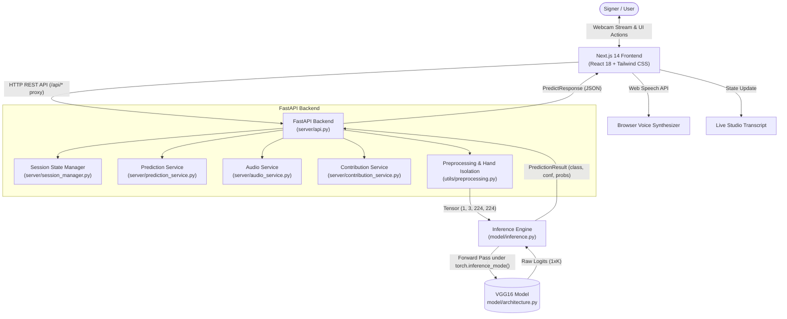
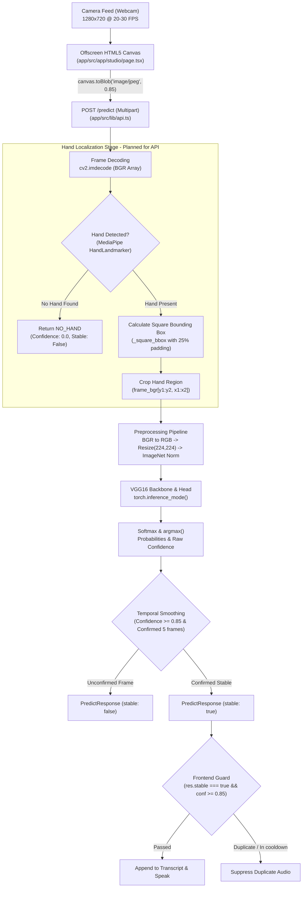
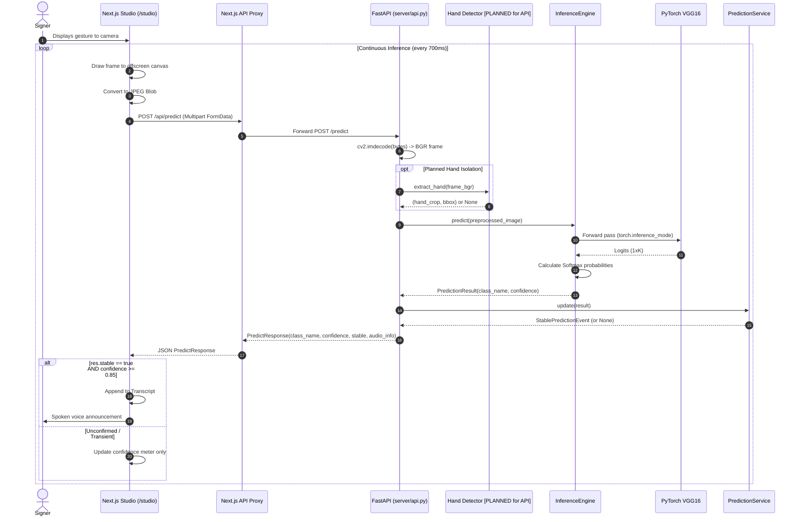
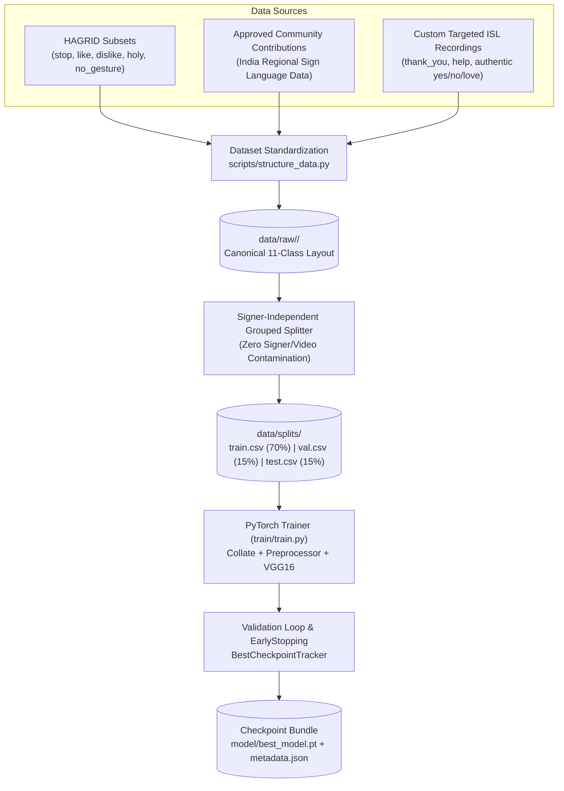
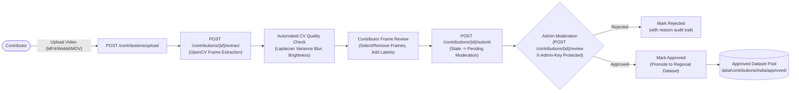

<div align="center">

# GESTURA

### Real-Time AI Sign Language Recognition & Community Contribution Platform

[](https://www.python.org/)
[](https://nextjs.org/)
[](https://fastapi.tiangolo.com/)
[](https://pytorch.org/)
[](https://www.typescriptlang.org/)
[](https://tailwindcss.com/)
[](https://opensource.org/licenses/MIT)

*A full-stack platform combining deep computer vision, temporal stabilization, real-time speech synthesis, and an India-first regional sign-language data contribution pipeline.*

---

</div>

## Table of Contents

- [1. Project Vision](#1-project-vision)
- [2. Problem Statement](#2-problem-statement)
- [3. Implementation Status Matrix](#3-implementation-status-matrix)
- [4. Key Features](#4-key-features)
- [5. Application Screenshots](#5-application-screenshots)
- [6. Technology Stack](#6-technology-stack)
- [7. System Architecture](#7-system-architecture)
- [8. Gesture Recognition Pipeline](#8-gesture-recognition-pipeline)
- [9. ML Model Architecture](#9-ml-model-architecture)
- [10. Dataset Architecture & Linguistic Vocabulary](#10-dataset-architecture--linguistic-vocabulary)
- [11. Community Contribution Workflow](#11-community-contribution-workflow)
- [12. Project Directory Structure](#12-project-directory-structure)
- [13. Installation and Setup](#13-installation-and-setup)
- [14. Environment Variables](#14-environment-variables)
- [15. Running Frontend and Backend](#15-running-frontend-and-backend)
- [16. Complete API Documentation (All 25 Endpoints)](#16-complete-api-documentation-all-25-endpoints)
- [17. Dataset Preparation](#17-dataset-preparation)
- [18. Model Training and Evaluation](#18-model-training-and-evaluation)
- [19. Testing and Quality Assurance](#19-testing-and-quality-assurance)
- [20. Security, Privacy, and Moderation](#20-security-privacy-and-moderation)
- [21. Development Workflow](#21-development-workflow)
- [22. Roadmap](#22-roadmap)
- [23. Contributing Guidelines](#23-contributing-guidelines)
- [24. License](#24-license)

---

## 1. Project Vision

**GESTURA** is designed to bridge the communication gap between Deaf/Hard-of-Hearing (DHH) signers and hearing individuals. Rather than treating sign language as a collection of arbitrary hand gestures, GESTURA approaches sign communication with linguistic respect, starting with an **India-First** initiative to document, recognize, and validate Indian Sign Language (ISL) and its regional dialects across India.

By pairing deep learning computer vision (PyTorch VGG16 with transfer learning) with a real-time web application (Next.js 14 + FastAPI), GESTURA enables real-time visual recognition, continuous transcript logging, spoken voice feedback, and crowd-sourced community dataset expansion.

---

## 2. Problem Statement

Sign languages are rich, visual-gestural languages that are frequently overlooked by audio-centric speech assistants. Developing production-grade sign recognition systems faces several core hurdles:

1. **Dataset Scarcity & Domain Mismatch**: Large-scale public gesture datasets (such as HAGRID) were collected for Human-Computer Interaction (HCI) commands (e.g., volume control, media pause, gaming) rather than formal sign languages. Crucial conversational phrases (such as *"Thank You"* or *"Help"*) do not exist in standard datasets.
2. **Regional Dialectal Variations**: In India, sign language conventions vary significantly between northern, southern, eastern, and western states. Centralized, monolithic models fail when applied across diverse regional communities.
3. **Inference Instability & False Positives**: Naive convolutional models classify every camera frame—including faces, clothing, and background furniture—into closed-set classes, producing erratic high-confidence false predictions (e.g., classifying a face as `OK` with 96% confidence).
4. **Data Leakage in Training**: Random frame-level shuffling across video recordings causes models to memorize specific signers and room environments rather than the gestures themselves, leading to high validation scores but zero real-world generalization.

GESTURA addresses these challenges through a modular architecture: strict hand localization, signer-independent dataset grouping, temporal prediction smoothing, and a localized community collection pipeline.

---

## 3. Implementation Status Matrix

To provide full transparency, every major feature and subsystem is classified below:

| Feature / Subsystem | Status | Technical Implementation Details in Codebase |
| :--- | :---: | :--- |
| **Next.js 14 Frontend** (`app/src/app/*`) | **IMPLEMENTED** | 8 complete routes (`/`, `/studio`, `/contribute`, `/gestures`, `/predict`, `/session`, `/model-info`, `/history`). |
| **FastAPI REST API Server** (`server/api.py`) | **IMPLEMENTED** | 25 fully functional routes covering prediction, sessions, geo data, contributions, and moderation. |
| **India-First Contribution Pipeline** (`server/contribution_service.py`, `app/src/app/contribute/`) | **IMPLEMENTED** | Video upload, OpenCV frame extraction, Laplacian blur scoring, thumbnail generation, regional metadata tagging. |
| **Indian Geographic Configuration** (`server/india_geo_config.py`) | **IMPLEMENTED** | Complete specification of 6 Indian regions, 36 states/UTs, and sign language varieties. |
| **Admin Moderation & Security** (`server/auth.py`) | **IMPLEMENTED** | Constant-time `hmac.compare_digest` with `X-Admin-Key` on moderation endpoints. Fails closed (`503`) if token unset. |
| **Temporal Prediction Smoothing** (`server/prediction_service.py`) | **IMPLEMENTED** | 5-frame sliding window, 0.85 confidence threshold, and cooldown state machine. |
| **PyTorch VGG16 Architecture** (`model/architecture.py`) | **IMPLEMENTED** | ImageNet feature extractor with modular dense classification head. |
| **Signer-Independent Grouped Splitter** (`data/contribution_dataset.py`) | **IMPLEMENTED** | `GroupedContributionSplitter` strictly isolates video/signer IDs across splits to eliminate data leakage. |
| **MediaPipe Hand Landmarker (Streamlit)** (`components/camera_view.py`) | **IMPLEMENTED** | HandLandmarker with 21 3D landmarks and padded square bounding box crop (`_square_bbox`). |
| **Hand Detection in FastAPI `/predict`** (`server/api.py`) | **PLANNED** | **Currently absent in API.** `server/api.py` directly resizes the full frame to 224x224. Hooking `HandDetector` into the API is designed in `docs/dataset_alignment_report.md`. |
| **11-Class Conversational Target Vocabulary** | **PLANNED** | Linguistic target vocabulary designed in `docs/dataset_alignment_report.md`. The active runtime in `config.yaml` currently operates on 22 HAGRID classes. |
| **Trained Production Checkpoint** (`model/best_model.pt`) | **PLANNED** | Checkpoint directories contain `.gitkeep`. Dense head uses random initialization; requires offline training on aligned dataset. |
| **Production Image Dataset** (`data/raw/`) | **PLANNED** | `data/raw/`, `data/processed/`, and `data/splits/` are empty in clean clones pending dataset curation. |

---

## 4. Key Features

- **Real-Time Live Studio (`/studio`)**: In-browser webcam streaming, offscreen frame extraction, live classification, visual confidence gauges, and Web Speech API audio synthesis.
- **India-First Contribution Portal (`/contribute`)**: Contributor pipeline supporting 6 Indian geographic regions, 36 states/UTs, conditional sign-language variety validation, and automated client/server video quality checks.
- **Automated Video Frame Extraction**: Automated OpenCV extraction of keyframes, Laplacian variance blur detection, brightness validation, and thumbnail generation.
- **Role-Based Moderation (`GET /contributions`, `POST /contributions/{id}/review`)**: Admin-authenticated review interface protected by constant-time secret token validation (`X-Admin-Key`).
- **Single-Image Prediction Studio (`/predict`)**: Drag-and-drop diagnostic interface for testing static images with full probability distribution graphs and latency metrics.
- **Isolated Session Management (`/session`)**: Per-session tracking of detection state, audio toggles, and rolling prediction histories over REST.
- **Vocabulary Explorer (`/gestures`)**: Interactive visual dictionary documenting supported signs, textual mappings, and dialectal notes.
- **Signer-Independent Dataset Splitter**: Custom dataset pipeline (`data/contribution_dataset.py`) guaranteeing zero video/signer contamination between training, validation, and test splits.

---

## 5. Application Screenshots

| Live Recognition Studio | Community Contribution Portal |
| :---: | :---: |
| <br>*Real-time camera feed with hand landmark overlays and live spoken transcript* | <br>*Regional video upload, automated quality checks, and frame selection* |

| Gesture Vocabulary Explorer | Dataset & Moderation Dashboard |
| :---: | :---: |
| <br>*Canonical sign vocabulary with dialect annotations* | <br>*Admin review and geographic distribution metrics* |

*(Note: If image assets are not present in your local clone, placeholder links will resolve once UI assets are rendered).*

---

## 6. Technology Stack

### Frontend Application (`app/`)
- **Framework**: [Next.js 14](https://nextjs.org/) (App Router, React 18, TypeScript 5.5)
- **Styling**: [Tailwind CSS 3.4](https://tailwindcss.com/) with a custom Dark Theme + Electric Blue design system
- **Motion & Icons**: [Framer Motion](https://www.framer.com/motion/) and [Lucide React](https://lucide.dev/)
- **Media & Browser APIs**: HTML5 Canvas (`toBlob`), `MediaDevices.getUserMedia`, Web Speech API (`SpeechSynthesis`)

### Backend API & Services (`server/`)
- **Web Framework**: [FastAPI 0.162](https://fastapi.tiangolo.com/) + [Starlette](https://www.starlette.io/)
- **ASGI Server**: [Uvicorn](https://www.uvicorn.org/)
- **Validation & Schemas**: [Pydantic v2](https://docs.pydantic.dev/)

### Machine Learning & Computer Vision (`model/`, `utils/`, `train/`)
- **Deep Learning**: [PyTorch 2.5+](https://pytorch.org/) & [TorchVision](https://pytorch.org/vision/) (VGG16 Backbone with transfer learning)
- **Computer Vision**: [OpenCV (opencv-python-headless 4.9+)](https://opencv.org/)
- **Hand Localization**: [Google MediaPipe](https://developers.google.com/mediapipe) HandLandmarker (Task Vision API)
- **Data Engineering**: NumPy, Pillow, Pandas, Scikit-learn (`GroupKFold`)

### Environment & Tooling
- **Package & Environment Manager**: [uv](https://github.com/astral-sh/uv) (Astral)
- **Node.js Package Manager**: `npm`
- **Testing**: [pytest 9.2](https://docs.pytest.org/), [httpx](https://www.python-httpx.org/)
- **Linters & Static Analysis**: Ruff, Mypy, Bandit

---

## 7. System Architecture

GESTURA is split into a client-side Next.js web application and a high-throughput FastAPI inference server. In production, Next.js rewrites `/api/*` to the FastAPI backend, shielding internal endpoints and isolating session states.



---

## 8. Gesture Recognition Pipeline

The recognition pipeline processes frames from client-side capture through neural inference and temporal confirmation.

> [!NOTE]
> **Implementation Clarification**: The diagram below illustrates the complete architectural pipeline. As noted in the [Implementation Status Matrix](#3-implementation-status-matrix), **Hand Localization in the FastAPI server is currently PLANNED** (the active implementation in `server/api.py` directly resizes whole frames to $224 \times 224$, while MediaPipe HandLandmarker cropping is currently implemented in `components/camera_view.py`).



### End-to-End Sequence Diagram



---

## 9. ML Model Architecture

GESTURA utilizes a transfer-learning convolutional neural network built upon a **torchvision VGG16** backbone with a modular, replaceable dense classification head:

```
[Input Tensor: 1 x 3 x 224 x 224 (RGB, ImageNet Normalized)]
                          │
                          ▼
            VGG16 Convolutional Backbone
            (13 Conv2D layers + 5 MaxPool2D layers)
            ImageNet Pretrained Feature Weights
                          │
                          ▼
             Flatten (25,088 features)
                          │
                          ▼
             Linear(25088 -> 4096) + ReLU
                          │
                          ▼
                    Dropout(p=0.5)
                          │
                          ▼
              Linear(4096 -> 4096) + ReLU
                          │
                          ▼
                    Dropout(p=0.5)
                          │
                          ▼
               Linear(4096 -> num_classes)
                          │
                          ▼
              Output Logits (1 x num_classes)
```

### Checkpoint Safety & Serialization
Checkpoints are loaded using safe deserialization (`torch.load(..., weights_only=True)`) to eliminate arbitrary pickle execution risks. Each checkpoint bundle contains:
```python
{
    "model_state_dict": ...,
    "num_classes": 22,
    "class_mapping": {"C": 0, "DOWN": 1, ..., "UP": 21},
    "architecture": "vgg16",
    "best_val_accuracy": 0.945,
    "epoch": 24
}
```

> [!IMPORTANT]
> **Engineering Status**: A comprehensive audit confirmed that `model/best_model.pt` is not yet trained in this environment. In the absence of a trained checkpoint, the dense classification head contains uncalibrated weights that can produce random outputs. Full production training must be executed following dataset curation.

---

## 10. Dataset Architecture & Linguistic Vocabulary

### Vocabulary Discrepancy & Alignment Plan
A comprehensive audit (`docs/dataset_alignment_report.md`) revealed a discrepancy between the active runtime and the project documentation:
- **Active Runtime (`config.yaml`, `server/api.py`)**: Currently configured with **22 HAGRID gesture classes** (`C, DOWN, FIST, FIVE, FOUR, HANG, HEAVY, INDEX, INDEX_LEFT, INDEX_RIGHT, LEFT, NONE, OK, PALM, PALM_M, PALM_U, RIGHT, THREE, THUMBS_DOWN, THUMBS_UP, TWO, UP`).
- **Linguistic Target Vocabulary (Phase 1, Planned)**: Designed for **11 conversational classes** (`HELLO, YES, NO, THANK_YOU, PLEASE, STOP, HELP, GOOD, BAD, LOVE, NONE`).

### Semantic Validity Matrix

| Target Sign | HAGRID Category | Semantic Assessment | Data Sourcing Action |
| :--- | :--- | :--- | :--- |
| **`STOP`** | `stop` | **Exact**: Identical open vertical palm. | Direct HAGRID download |
| **`GOOD`** | `like` | **Valid Proxy**: Thumbs up represents approval. | Direct HAGRID download |
| **`BAD`** | `dislike` | **Valid Proxy**: Thumbs down represents disapproval. | Direct HAGRID download |
| **`PLEASE`** | `holy` | **Valid (ISL)**: Palms pressed together (Namaste/request). | Direct HAGRID download |
| **`NONE`** | `no_gesture` | **Exact**: Ambient hands and non-gesturing postures. | Direct HAGRID download |
| **`HELLO`** | `palm` | **Partial**: Static palm differs from dynamic wave. | Custom ISL collection required |
| **`YES`** | `fist` | **Invalid**: Formal sign requires vertical fist nod. | Custom ISL collection required |
| **`NO`** | `xsign` | **Invalid**: Formal sign requires finger pinch/wag. | Custom ISL collection required |
| **`THANK_YOU`**| *None* | **Zero Overlap**: Chin-to-outward movement absent. | Custom ISL collection mandatory |
| **`HELP`** | *None* | **Zero Overlap**: Two-handed fist lift absent. | Custom ISL collection mandatory |
| **`LOVE`** | `hand_heart` | **Valid Variant**: Two-handed heart pose. | HAGRID variant + custom ILY |

### Signer-Independent Grouped Splitting
To prevent data leakage, GESTURA requires that all frames from a given video recording or signer ID remain exclusively within one split. Random shuffling of individual video frames is strictly prohibited.



---

## 11. Community Contribution Workflow

GESTURA features an India-first regional contribution pipeline designed to preserve dialectal integrity.



### Geographic Hierarchy
```
India (Country)
└── 6 Regions (North, South, East, West, Northeast, Central)
    └── 36 States & Union Territories
        └── Sign Language Varieties (ISL Standard vs. Regional Dialects)
            └── Gestures (Category, Name, Meaning)
```

---

## 12. Project Directory Structure

```
GESTURA/
├── app/                          # Next.js 14 Frontend Application
│   ├── src/
│   │   ├── app/                  # App Router Pages
│   │   │   ├── page.tsx          # Dashboard / Home
│   │   │   ├── studio/           # Real-Time Live Studio (Camera + Audio)
│   │   │   ├── contribute/       # India-First Contribution Portal
│   │   │   ├── gestures/         # Gesture Vocabulary Explorer
│   │   │   ├── predict/          # Single Image Diagnostic Tool
│   │   │   ├── session/          # Session State Management
│   │   │   ├── model-info/       # Model Architecture & Metadata
│   │   │   ├── history/          # Historical Prediction Logs
│   │   │   └── about/            # Project Overview & Mission
│   │   ├── components/           # Navbar, Footer, Cards, Badges
│   │   └── lib/api.ts            # Typed HTTP Client to FastAPI
│   ├── package.json              # Node.js dependencies
│   ├── tailwind.config.ts        # Design system & dark theme tokens
│   └── tsconfig.json             # TypeScript configuration
│
├── server/                       # FastAPI Backend & Services
│   ├── api.py                    # FastAPI route definitions (25 endpoints)
│   ├── api_models.py             # Pydantic request/response models
│   ├── auth.py                   # Constant-time admin key validation
│   ├── audio_service.py          # Audio queue & duplicate prevention
│   ├── camera_server.py          # Camera state lifecycle
│   ├── contribution_models.py    # Contribution Pydantic schemas
│   ├── contribution_service.py   # Regional contribution filesystem manager
│   ├── india_geo_config.py       # India geographic & dialect reference
│   ├── prediction_service.py     # Temporal smoothing & confirmation
│   └── session_manager.py        # Isolated per-session scopes
│
├── model/                        # PyTorch Model & Inference Engine
│   ├── architecture.py           # VGG16 backbone + replaceable head
│   ├── classifier.py             # ModelConfig & canonical class mapping
│   ├── inference.py              # Thread-safe InferenceEngine
│   ├── model_loader.py           # Safe checkpoint loading (weights_only=True)
│   ├── checkpoint.py             # CheckpointBundle persistence
│   ├── weights/                  # Versioned model weights (.gitkeep)
│   └── exports/                  # ONNX / TorchScript exports (.gitkeep)
│
├── data/                         # Datasets & Contribution Storage
│   ├── dataset.py                # PyTorch GestureDataset
│   ├── contribution_dataset.py   # GroupedContributionSplitter (Zero leakage)
│   ├── contributions/            # Contribution records (approved/pending/rejected)
│   ├── raw/                      # Raw training images by class (immutable)
│   ├── processed/                # Normalized processed frames
│   └── splits/                   # train.csv, validation.csv, test.csv
│
├── train/                        # Offline Training Pipeline
│   ├── train.py                  # CLI training entry point
│   ├── trainer.py                # PyTorch training & validation loop
│   ├── loss.py                   # Loss function definitions
│   ├── optimizer.py              # Optimizer builders (AdamW)
│   ├── scheduler.py              # Learning rate schedulers
│   └── callbacks.py              # EarlyStopping & BestCheckpointTracker
│
├── utils/                        # Shared Computer Vision Utilities
│   ├── preprocessing.py          # Preprocessor (train == inference pipeline)
│   ├── augmentation.py           # Semantic-preserving augmentations
│   ├── assets.py                 # MediaPipe task model caching (.model_cache/)
│   ├── device.py             # Device selection (CUDA / CPU fallback)
│   ├── logging.py                # Centralized application logging
│   └── metrics.py                # Precision, recall, F1, and latency metrics
│
├── scripts/                      # Executable Automation Scripts
│   ├── run_api.py                # Start the FastAPI server via Uvicorn
│   ├── collect_data.py           # Webcam frame collection utility
│   ├── download_dataset.py       # HAGRID selective archive downloader
│   ├── prepare_dataset.py        # Structure folders and generate splits
│   ├── evaluate.py               # Checkpoint benchmark evaluation
│   └── export_model.py           # Export checkpoint to TorchScript or ONNX
│
├── test/                         # Pytest Automated Test Suite
│   ├── test_api.py               # Core API endpoint tests
│   ├── test_contributions.py     # Regional contribution & admin auth tests
│   ├── test_camera.py            # Prediction smoothing tests
│   ├── test_model.py             # PyTorch architecture & parameter tests
│   ├── test_preprocessing.py     # Preprocessing tensor conversion tests
│   └── test_inference.py         # InferenceEngine tests
│
├── docs/                         # In-Depth Engineering Documentation
│   ├── dataset_alignment_report.md # Dataset inventory & mapping audit
│   ├── architecture.md           # Deep architectural specification
│   ├── dataset.md                # Dataset organization guidelines
│   ├── training.md               # Training instructions & hyperparameters
│   ├── security.md               # Security model & threat analysis
│   └── rules.md                  # Development principles & standards
│
├── config.yaml                   # Central application configuration
├── pyproject.toml                # Python package manifest & tool config
└── requirements.txt              # Pinned Python dependencies
```

---

## 13. Installation and Setup

### Prerequisites
- **Python**: Version `3.11` (pinned in `.python-version`)
- **Node.js**: Version `18.x` or `20.x` LTS
- **Package Managers**: `uv` (recommended for Python) and `npm`

### 1. Clone the Repository
```bash
git clone https://github.com/your-org/GESTURA.git
cd GESTURA
```

### 2. Backend Setup (Python)
Using `uv` (recommended):
```bash
# Pin Python 3.11 and create virtual environment
uv python pin 3.11
uv venv venv

# Activate virtual environment
# Linux/macOS:
source venv/bin/activate
# Windows PowerShell:
.\venv\Scripts\Activate.ps1

# Sync dependencies from uv.lock
uv sync
```

Alternatively, using standard `pip`:
```bash
python -m venv venv
source venv/bin/activate  # Or .\venv\Scripts\Activate.ps1 on Windows
pip install -r requirements.txt
```

### 3. Frontend Setup (Next.js)
```bash
cd app
npm install
cd ..
```

---

## 14. Environment Variables

### Backend Configuration (`server/`)
Create a `.env` file in the root directory (or export variables in your shell):

| Variable | Required | Default | Description |
| :--- | :---: | :--- | :--- |
| `GESTURA_ADMIN_TOKEN` | **Yes** (for moderation) | *None* | Secret key for admin moderation endpoints (`X-Admin-Key`). |
| `PORT` | No | `8000` | Port for the FastAPI HTTP server. |
| `HOST` | No | `0.0.0.0` | Host interface binding. |

### Frontend Configuration (`app/`)
Create `app/.env` (see `app/.env.example`):

| Variable | Required | Default | Description |
| :--- | :---: | :--- | :--- |
| `NEXT_PUBLIC_API_URL` | **Yes** | `http://localhost:8000` | Base URL for FastAPI backend requests. |
| `NEXT_PUBLIC_BACKEND_URL`| **Yes** | `http://localhost:8000` | Fallback reference for external backend services. |
| `BACK_END_url` | No | `http://localhost:8000` | Alternative mapping for backend host proxies. |

---

## 15. Running Frontend and Backend

### Option A: Run Both Services (Development)

**Terminal 1 — Backend API Server:**
```bash
# Activate virtual environment first
source venv/bin/activate  # Windows: .\venv\Scripts\Activate.ps1

# Start FastAPI via convenience script
python scripts/run_api.py --port 8000 --reload

# Or directly with Uvicorn:
uvicorn server.api:app --host 0.0.0.0 --port 8000 --reload
```
The interactive Swagger API documentation will be available at `http://localhost:8000/docs`.

**Terminal 2 — Next.js Web Frontend:**
```bash
cd app
npm run dev
```
Open [http://localhost:3000](http://localhost:3000) in your browser.

### Option B: Production Build (Frontend)
```bash
cd app
npm run build
npm start
```

---

## 16. Complete API Documentation (All 25 Endpoints)

The FastAPI server provides 25 operational endpoints organized into 5 functional domains:

### Category A: Core Prediction & Vocabulary (4 Endpoints)

| Method | Endpoint | Auth | Purpose & Parameters |
| :--- | :--- | :---: | :--- |
| `GET` | `/health` | None | Service health and model load state. |
| `GET` | `/model/info` | None | Architecture, classes, input size, and device configuration. |
| `GET` | `/gestures` | None | Supported vocabulary and text translations. |
| `POST` | `/predict` | None | Upload frame for classification. Form: `image` (file, max 10MB), `session_id`. Header: `X-Session-Id`. |

### Category B: Session State Management (10 Endpoints)

| Method | Endpoint | Auth | Purpose & Parameters |
| :--- | :--- | :---: | :--- |
| `GET` | `/session/{id}/status` | None | Session camera, detection, audio state, and latest prediction. |
| `POST` | `/session/{id}/detection/start` | None | Enable detection for the specified session. |
| `POST` | `/session/{id}/detection/stop` | None | Disable detection for the specified session. |
| `POST` | `/session/{id}/audio/enable` | None | Enable audio playback for the session. |
| `POST` | `/session/{id}/audio/disable` | None | Disable audio playback for the session. |
| `GET` | `/session/{id}/audio/status` | None | Retrieve audio queue and announcement state. |
| `GET` | `/session/{id}/history` | None | Get chronological prediction history for session. |
| `DELETE` | `/session/{id}/history` | None | Clear session prediction history. |
| `POST` | `/session/{id}/reset` | None | Reset smoothing, audio, and history for session. |
| `DELETE` | `/session/{id}` | None | Destroy session scope and release resources. |

### Category C: India Geography & Public Datasets (5 Endpoints)

| Method | Endpoint | Auth | Purpose & Parameters |
| :--- | :--- | :---: | :--- |
| `GET` | `/contributions/geo/regions` | None | Returns the 6 configured Indian regions (`NORTH`, `SOUTH`, etc.). |
| `GET` | `/contributions/geo/states` | None | Returns states/UTs for a region. Query: `region=NORTH`. |
| `GET` | `/contributions/geo/sign-language-types` | None | Returns supported sign-language classifications. |
| `GET` | `/contributions/dataset/stats` | None | Aggregated counts of total, pending, approved, and rejected contributions. |
| `GET` | `/contributions/dataset/approved` | None | Lists public approved samples. Queries: `region`, `variety`. Signer IDs sanitized. |

### Category D: Community Contribution Pipeline (4 Endpoints)

| Method | Endpoint | Auth | Purpose & Parameters |
| :--- | :--- | :---: | :--- |
| `POST` | `/contributions/upload` | None | Upload gesture video (MP4/WebM/MOV, max 50MB). Form: `video`, `signer_id`. |
| `POST` | `/contributions/{id}/extract` | None | Extract video frames. JSON body: `max_frames`, `frame_interval`. |
| `GET` | `/contributions/{id}` | None | Retrieve metadata, status, and frame list for contribution. |
| `POST` | `/contributions/{id}/submit` | None | Submit validated frames and metadata for moderation. |

### Category E: Administrative Moderation (2 Endpoints — Protected)

| Method | Endpoint | Auth | Purpose & Parameters |
| :--- | :--- | :---: | :--- |
| `GET` | `/contributions` | `X-Admin-Key` | List contributions across all statuses. Queries: `status`, `region`. |
| `POST` | `/contributions/{id}/review` | `X-Admin-Key` | Approve or reject a submission. Body: `{"approved": bool, "rejection_reason": str}`. |

---

## 17. Dataset Preparation

### 1. Selective HAGRID Download
Download only the semantically valid subsets (`stop`, `like`, `dislike`, `holy`, `no_gesture`) rather than the full 400 GB dataset:
```bash
python scripts/download_dataset.py --dataset \
  --targets stop like dislike holy no_gesture \
  --max-images-per-class 1000
```

### 2. Prepare Split Manifests
Structure the downloaded images into `data/raw/<CLASS>/` and create stratified split manifests:
```bash
python scripts/prepare_dataset.py \
  --source ./hagrid/dataset/ \
  --dest data/raw/ \
  --max-images-per-class 1000 \
  --seed 42
```

---

## 18. Model Training and Evaluation

> [!IMPORTANT]
> **Prerequisite**: Training requires populating `data/raw/<CLASS>/` with valid image directories before executing. Training against an empty directory will raise a `FileNotFoundError`.

### 1. Run Model Training
```bash
python -m train.train \
  --data-root data/raw \
  --config config.yaml \
  --output-dir model \
  --epochs 50 \
  --batch-size 32 \
  --learning-rate 0.0001 \
  --device auto
```
Trained checkpoints are persisted to `model/best_model.pt` alongside an evaluation sidecar `model/best_model.json`.

### 2. Model Evaluation
Evaluate a trained checkpoint against test splits to generate precision, recall, F1, and confusion matrices:
```bash
python scripts/evaluate.py \
  --config config.yaml \
  --checkpoint model/best_model.pt \
  --data-root data/raw \
  --output outputs/metrics/evaluation.json
```

### 3. Model Export
Export the PyTorch model for deployment:
```bash
# Export to TorchScript (.pt)
python scripts/export_model.py --checkpoint model/best_model.pt --format torchscript

# Export to ONNX (.onnx)
python scripts/export_model.py --checkpoint model/best_model.pt --format onnx
```

---

## 19. Testing and Quality Assurance

The codebase includes comprehensive unit and integration tests across the API, prediction state machines, regional validations, and model architectures.

### Run Python Test Suite
```bash
# Run all 50 tests using local temp directory (avoids Windows temp permission locks)
pytest --basetemp=.pytest_temp -v

# Run API tests specifically
pytest test/test_api.py test/test_contributions.py -v
```

### Run Frontend Type Checks & Production Build
```bash
cd app
# Check TypeScript types
npx tsc --noEmit

# Execute Next.js build
npm run build
cd ..
```

### Code Formatting & Static Analysis
```bash
# Lint code with Ruff
ruff check .

# Static type check
mypy model server utils train --ignore-missing-imports

# Security scan
bandit -r model server train utils
```

---

## 20. Security, Privacy, and Moderation

1. **Camera Privacy**: Camera access is explicitly opt-in via browser permissions. Frames processed in the live studio are evaluated in memory and **never persisted** to disk.
2. **Moderation Access Control**: Admin endpoints enforce constant-time cryptographic token verification (`hmac.compare_digest`) via the `X-Admin-Key` header. If `GESTURA_ADMIN_TOKEN` is unconfigured, the system fails closed with `503 Service Unavailable`.
3. **Contributor Privacy**: Public approved contribution APIs (`GET /contributions/dataset/approved`) strip personal identifying information, IP addresses, and raw emails before publishing sample metadata.
4. **Safe Deserialization**: PyTorch models are loaded strictly with `weights_only=True` to prevent arbitrary code execution vulnerabilities from untrusted checkpoints.
5. **Payload Protections**: File uploads are capped at 10 MB for images and 50 MB for contribution videos, with strict format validation using OpenCV decoders.

---

## 21. Development Workflow

1. **Branching Model**:
   - `main`: Production-ready release branch.
   - `feat/*`: Feature branches (e.g., `feat/community-gesture-contributions`).
   - `fix/*`: Bug fixes and pipeline patches.
2. **Commit Standards**: Write concise, descriptive commit messages adhering to Conventional Commits format (`feat:`, `fix:`, `docs:`, `test:`, `refactor:`).
3. **Pull Request Protocol**:
   - Verify `pytest` passes with 0 failures.
   - Verify `npm run build` passes with 0 type errors.
   - Run `ruff check .` and resolve all lint issues before requesting review.

---

## 22. Roadmap

- [x] **Phase 1**: FastAPI backend and Next.js 14 Web Studio architecture.
- [x] **Phase 2**: India-first regional community gesture contribution portal.
- [x] **Phase 3**: Constant-time administrative authentication and moderation APIs.
- [x] **Phase 4**: Inference pipeline audit and dataset alignment documentation.
- [ ] **Phase 5**: Integration of MediaPipe HandLandmarker cropping inside `POST /predict`.
- [ ] **Phase 6**: Targeted data acquisition for missing ISL classes (`THANK_YOU`, `HELP`, authentic `YES`/`NO`).
- [ ] **Phase 7**: Production model training on aligned 11-class vocabulary with signer-independent splits.
- [ ] **Phase 8**: Sequential temporal gesture recognition (CNN + LSTM / Video Transformers) for dynamic signs.
- [ ] **Phase 9**: Edge on-device browser inference via WebAssembly and ONNX Runtime Web.

---

## 23. Contributing Guidelines

We welcome contributions from software engineers, machine learning researchers, and sign-language communities:

1. **Sign Language Contributors**: Visit `/contribute` in the web application to submit regional sign-language video recordings.
2. **Code Contributors**:
   - Fork the repository and create a feature branch (`git checkout -b feat/my-feature`).
   - Ensure all code conforms to existing types and lint rules.
   - Add test coverage in `test/` for all new endpoints or logic.
   - Open a Pull Request detailing the changes and verification steps.

---

## 24. License

This project is licensed under the **MIT License**. See the [LICENSE](LICENSE) file for details.

---

<div align="center">
<sub>Built with linguistic respect for the Deaf and Hard-of-Hearing community.</sub>
</div>
