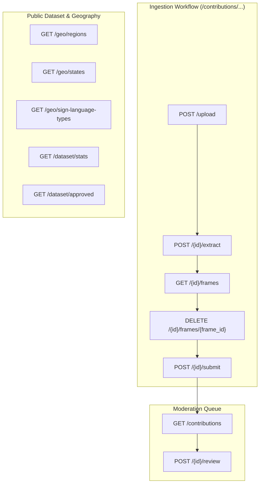

# GESTURA Community Gesture Contribution API Reference

## 1. Overview & Architecture

The **GESTURA Community Gesture Contribution API** provides a complete end-to-end suite of RESTful endpoints supporting an India-first dataset strategy for sign-language recognition. It manages video ingestion, computer-vision frame extraction and quality auditing, strict India-specific geographic hierarchy validation, moderation workflows, aggregate dataset analytics, and sanitized public dataset syndication.

### Base URL & Proxy Routing
- **Direct Backend**: `http://localhost:8000`
- **Next.js Reverse Proxy**: `/api/contributions/...` $\longrightarrow$ `http://localhost:8000/contributions/...`
- **Interactive OpenAPI Documentation**:
  - Swagger UI: `http://localhost:8000/docs`
  - ReDoc: `http://localhost:8000/redoc`
  - OpenAPI JSON Specification: `http://localhost:8000/openapi.json`

### Authentication & Access Control
| Endpoint Category | Route Prefix | Access Level | Authentication Header |
| :--- | :--- | :--- | :--- |
| **Ingestion** | `/contributions/upload`, `/contributions/{id}/*` | Public / Contributor | None (CORS protected) |
| **Geography** | `/contributions/geo/*` | Public | None |
| **Dataset (Public)** | `/contributions/dataset/*` | Public (Anonymized) | None |
| **Moderation** | `/contributions/{id}/review`, `/contributions` | Admin / Moderator | `X-Admin-Key: <GESTURA_ADMIN_TOKEN>` |

> [!IMPORTANT]
> **Privacy & Anonymization Guarantee**: Public dataset endpoints (`/contributions/dataset/approved`) permanently strip private contributor IDs (`contributor_id`), raw video download paths, and internal server filesystem paths (`file_path`, `thumb_path`) to prevent identity disclosure and server reconnaissance.

---

## 2. API Endpoints Catalog



---

## 3. Geography APIs (`Contributions - Geography`)

### 3.1 `GET /contributions/geo/regions`
Returns all six configured Indian geographical regions for gesture contribution provenance.

- **Method**: `GET`
- **Path**: `/contributions/geo/regions`
- **Authentication**: None
- **Query Parameters**: None
- **Status Codes**:
  - `200 OK`: Regions successfully retrieved.

#### Request Example (cURL)
```bash
curl -X GET "http://localhost:8000/contributions/geo/regions" \
  -H "Accept: application/json"
```

#### Response Example (`200 OK`)
```json
{
  "country": "India",
  "regions": [
    "NORTH",
    "SOUTH",
    "EAST",
    "WEST",
    "CENTRAL",
    "NORTHEAST"
  ],
  "count": 6
}
```

---

### 3.2 `GET /contributions/geo/states`
Returns all states and union territories belonging to the specified Indian geographical region.

- **Method**: `GET`
- **Path**: `/contributions/geo/states`
- **Authentication**: None
- **Query Parameters**:
  - `region` (string, required): Indian region name (`NORTH`, `SOUTH`, `EAST`, `WEST`, `CENTRAL`, `NORTHEAST`). Case-insensitive.
- **Status Codes**:
  - `200 OK`: States and UTs successfully retrieved.
  - `400 Bad Request`: Invalid region name specified.
  - `422 Unprocessable Entity`: Missing `region` query parameter.

#### Request Example (cURL)
```bash
curl -X GET "http://localhost:8000/contributions/geo/states?region=SOUTH" \
  -H "Accept: application/json"
```

#### Response Example (`200 OK`)
```json
{
  "region": "SOUTH",
  "states": [
    "Andhra Pradesh",
    "Karnataka",
    "Kerala",
    "Tamil Nadu",
    "Telangana",
    "Puducherry",
    "Lakshadweep",
    "Andaman and Nicobar Islands"
  ],
  "count": 8
}
```

#### Error Response (`400 Bad Request`)
```json
{
  "detail": "Invalid region 'PACIFIC'. Must be one of: CENTRAL, EAST, NORTH, NORTHEAST, SOUTH, WEST"
}
```

---

### 3.3 `GET /contributions/geo/sign-language-types`
Returns supported sign language classifications (ISL, Regional ISL Variant, etc.) and validation rules detailing whether specific variety names are required.

- **Method**: `GET`
- **Path**: `/contributions/geo/sign-language-types`
- **Authentication**: None
- **Query Parameters**: None
- **Status Codes**:
  - `200 OK`: Classifications successfully retrieved.

#### Request Example (cURL)
```bash
curl -X GET "http://localhost:8000/contributions/geo/sign-language-types" \
  -H "Accept: application/json"
```

#### Response Example (`200 OK`)
```json
{
  "types": [
    {
      "name": "Indian Sign Language (ISL)",
      "requires_variety_name": false,
      "description": "Standardized pan-Indian sign language."
    },
    {
      "name": "Regional ISL Variant",
      "requires_variety_name": true,
      "description": "Regional dialect variety of ISL requiring variety or dialect specification."
    },
    {
      "name": "Local Community Sign Language",
      "requires_variety_name": true,
      "description": "Indigenous, village, or local deaf community sign language."
    },
    {
      "name": "Other",
      "requires_variety_name": true,
      "description": "Distinct sign language system requiring description."
    },
    {
      "name": "Unsure",
      "requires_variety_name": false,
      "description": "Uncertain dialectal classification."
    }
  ],
  "count": 5
}
```

---

## 4. Dataset APIs (`Contributions - Dataset`)

### 4.1 `GET /contributions/dataset/stats`
Returns aggregated metrics on community contributions: totals, pending, approved, rejected, breakdowns by region, state, and sign language variety, and total extracted frames.

- **Method**: `GET`
- **Path**: `/contributions/dataset/stats`
- **Authentication**: None
- **Query Parameters**: None
- **Status Codes**:
  - `200 OK`: Aggregated statistics calculated and returned.

#### Request Example (cURL)
```bash
curl -X GET "http://localhost:8000/contributions/dataset/stats" \
  -H "Accept: application/json"
```

#### Response Example (`200 OK`)
```json
{
  "total_contributions": 42,
  "pending_contributions": 12,
  "approved_contributions": 28,
  "rejected_contributions": 2,
  "by_region": {
    "NORTH": 14,
    "SOUTH": 16,
    "EAST": 4,
    "WEST": 5,
    "CENTRAL": 1,
    "NORTHEAST": 2
  },
  "by_state": {
    "Delhi": 10,
    "Tamil Nadu": 8,
    "Karnataka": 6,
    "Maharashtra": 5,
    "Punjab": 4,
    "West Bengal": 4,
    "Kerala": 2,
    "Assam": 2,
    "Madhya Pradesh": 1
  },
  "by_sign_language_type": {
    "Indian Sign Language (ISL)": 30,
    "Regional ISL Variant": 8,
    "Local Community Sign Language": 3,
    "Other": 1,
    "Unsure": 0
  },
  "total_extracted_frames": 1184
}
```

---

### 4.2 `GET /contributions/dataset/approved`
Returns paginated metadata for approved contributions. Excludes private contributor details, local filesystem paths, and raw video download URLs.

- **Method**: `GET`
- **Path**: `/contributions/dataset/approved`
- **Authentication**: None
- **Query Parameters**:
  - `page` (integer, optional, default: `1`, minimum: `1`): Page number (1-based).
  - `page_size` (integer, optional, default: `20`, range: `1` to `100`): Items per page.
  - `region` (string, optional): Filter by region (`NORTH`, `SOUTH`, etc.).
  - `state` (string, optional): Filter by state or UT.
  - `sign_language_type` (string, optional): Filter by classification name.
  - `gesture_name` (string, optional): Substring filter on gesture name.
- **Status Codes**:
  - `200 OK`: Filtered, paginated metadata returned.

#### Request Example (cURL)
```bash
curl -X GET "http://localhost:8000/contributions/dataset/approved?region=SOUTH&page=1&page_size=10" \
  -H "Accept: application/json"
```

#### Response Example (`200 OK`)
```json
{
  "items": [
    {
      "contribution_id": "c_9f83a21e_20261031",
      "gesture_name": "VANAKKAM",
      "meaning": "Traditional Tamil sign greeting",
      "category": "Greetings",
      "gesture_type": "dynamic",
      "country": "India",
      "region": "SOUTH",
      "state": "Tamil Nadu",
      "district_city": "Chennai",
      "sign_language_type": "Regional ISL Variant",
      "variety_name": "Chennai Dialect",
      "video_duration_seconds": 2.4,
      "usable_frame_count": 24,
      "created_at": 1793462400.0
    }
  ],
  "total": 1,
  "page": 1,
  "page_size": 10,
  "total_pages": 1
}
```

---

## 5. Ingestion Workflow APIs (`Contributions - Ingestion`)

### 5.1 `POST /contributions/upload`
Uploads an MP4/WebM/MOV gesture video, validates file format, duration, and size limits, and creates a staging contribution record.

- **Method**: `POST`
- **Path**: `/contributions/upload`
- **Authentication**: None
- **Request Body**: `multipart/form-data` with `file: Binary`
- **Validation Constraints**:
  - Supported formats: `.mp4`, `.mov`, `.webm`, `.avi`, `.mkv`
  - Maximum upload size: `50 MB`
  - Duration range: `0.3s` to `60.0s`
- **Status Codes**:
  - `201 Created`: Video uploaded and validated.
  - `400 Bad Request`: Invalid file format or video duration out of bounds.

#### Request Example (cURL)
```bash
curl -X POST "http://localhost:8000/contributions/upload" \
  -F "file=@gesture_sample.mp4;type=video/mp4"
```

#### Response Example (`201 Created`)
```json
{
  "contribution_id": "c_d4f8e12b_20261031",
  "video_filename": "gesture_sample.mp4",
  "duration_seconds": 3.2,
  "fps": 25.0,
  "resolution": [1920, 1080],
  "total_video_frames": 80,
  "status": "uploaded"
}
```

---

### 5.2 `POST /contributions/{contribution_id}/extract`
Extracts candidate gesture frames at `sample_interval`, generates 224x224 RGB thumbnails, and computes sharpness, darkness, and temporal duplication metrics.

- **Method**: `POST`
- **Path**: `/contributions/{contribution_id}/extract`
- **Path Parameters**:
  - `contribution_id` (string, required): Contribution identifier.
- **Request Body**: `application/json`
  ```json
  {
    "sample_interval": 5,
    "max_frames": 40
  }
  ```
- **Status Codes**:
  - `200 OK`: Frame extraction completed with quality report.
  - `404 Not Found`: Contribution ID not found.

#### Request Example (cURL)
```bash
curl -X POST "http://localhost:8000/contributions/c_d4f8e12b_20261031/extract" \
  -H "Content-Type: application/json" \
  -d '{"sample_interval": 5, "max_frames": 40}'
```

#### Response Example (`200 OK`)
```json
{
  "contribution_id": "c_d4f8e12b_20261031",
  "sample_interval": 5,
  "total_extracted": 16,
  "usable_count": 15,
  "quality_report": {
    "total_frames_extracted": 16,
    "usable_frames_count": 15,
    "blurry_frames_count": 1,
    "duplicate_frames_count": 0,
    "dark_frames_count": 0,
    "warnings": [
      "Frame 0 flagged as blurry (Laplacian variance 18.4 < 25.0)"
    ]
  },
  "frames": [
    {
      "frame_id": "frame_0000",
      "filename": "frame_0000.jpg",
      "thumb_filename": "frame_0000_thumb.jpg",
      "timestamp_ms": 0.0,
      "frame_index": 0,
      "width": 1920,
      "height": 1080,
      "sharpness_score": 18.4,
      "is_blurry": true,
      "is_duplicate": false,
      "is_dark": false,
      "status": "removed"
    },
    {
      "frame_id": "frame_0005",
      "filename": "frame_0005.jpg",
      "thumb_filename": "frame_0005_thumb.jpg",
      "timestamp_ms": 200.0,
      "frame_index": 5,
      "width": 1920,
      "height": 1080,
      "sharpness_score": 68.2,
      "is_blurry": false,
      "is_duplicate": false,
      "is_dark": false,
      "status": "active"
    }
  ]
}
```

---

### 5.3 `GET /contributions/{contribution_id}`
Retrieves the complete internal metadata for a contribution.

- **Method**: `GET`
- **Path**: `/contributions/{contribution_id}`
- **Authentication**: None
- **Path Parameters**:
  - `contribution_id` (string, required): Target contribution ID.
- **Status Codes**:
  - `200 OK`: Contribution metadata returned.
  - `404 Not Found`: Contribution ID not found.

#### Request Example (cURL)
```bash
curl -X GET "http://localhost:8000/contributions/c_d4f8e12b_20261031" \
  -H "Accept: application/json"
```

#### Response Example (`200 OK`)
```json
{
  "contribution_id": "c_d4f8e12b_20261031",
  "status": "pending_approval",
  "video_filename": "gesture_sample.mp4",
  "video_duration_seconds": 3.2,
  "video_fps": 25.0,
  "video_resolution": [1920, 1080],
  "total_video_frames": 80,
  "country": "India",
  "region": "NORTH",
  "state": "Delhi",
  "district_city": "New Delhi",
  "sign_language_type": "Indian Sign Language (ISL)",
  "variety_name": null,
  "gesture_name": "NAMASTE",
  "meaning": "Formal Indian greeting",
  "category": "Greetings",
  "description": "Two hands pressed together palms facing inward",
  "gesture_type": "static",
  "contributor_id": "user_delhi_01",
  "sample_interval": 5,
  "usable_frame_count": 15,
  "rejection_reason": null,
  "created_at": 1793462000.0,
  "updated_at": 1793462100.0
}
```

---

### 5.4 `GET /contributions/{contribution_id}/frames`
Returns all extracted frames and their status (`active` or `removed`) for a contribution.

- **Method**: `GET`
- **Path**: `/contributions/{contribution_id}/frames`
- **Authentication**: None
- **Status Codes**:
  - `200 OK`: Frame list retrieved.
  - `404 Not Found`: Contribution not found.

#### Request Example (cURL)
```bash
curl -X GET "http://localhost:8000/contributions/c_d4f8e12b_20261031/frames" \
  -H "Accept: application/json"
```

#### Response Example (`200 OK`)
```json
{
  "contribution_id": "c_d4f8e12b_20261031",
  "total_frames": 16,
  "active_frames": 15,
  "frames": [
    {
      "frame_id": "frame_0005",
      "filename": "frame_0005.jpg",
      "thumb_filename": "frame_0005_thumb.jpg",
      "timestamp_ms": 200.0,
      "frame_index": 5,
      "width": 1920,
      "height": 1080,
      "sharpness_score": 68.2,
      "is_blurry": false,
      "is_duplicate": false,
      "is_dark": false,
      "status": "active"
    }
  ]
}
```

---

### 5.5 `GET /contributions/{contribution_id}/frames/{frame_id}`
Streams the full resolution JPEG image of an extracted frame.

- **Method**: `GET`
- **Path**: `/contributions/{contribution_id}/frames/{frame_id}`
- **Authentication**: None
- **Status Codes**:
  - `200 OK`: Binary image streamed (`image/jpeg`).
  - `404 Not Found`: Frame or contribution not found.

#### Request Example (cURL)
```bash
curl -X GET "http://localhost:8000/contributions/c_d4f8e12b_20261031/frames/frame_0005" \
  --output frame_0005.jpg
```

---

### 5.6 `GET /contributions/{contribution_id}/frames/{frame_id}/thumb`
Streams the lightweight 224x224 thumbnail JPEG image of an extracted frame.

- **Method**: `GET`
- **Path**: `/contributions/{contribution_id}/frames/{frame_id}/thumb`
- **Authentication**: None
- **Status Codes**:
  - `200 OK`: Binary thumbnail image streamed (`image/jpeg`).
  - `404 Not Found`: Thumbnail or contribution not found.

#### Request Example (cURL)
```bash
curl -X GET "http://localhost:8000/contributions/c_d4f8e12b_20261031/frames/frame_0005/thumb" \
  --output frame_0005_thumb.jpg
```

---

### 5.7 `DELETE /contributions/{contribution_id}/frames/{frame_id}`
Marks an extracted frame as `removed` so it is excluded from dataset splits and ML training exports.

- **Method**: `DELETE`
- **Path**: `/contributions/{contribution_id}/frames/{frame_id}`
- **Authentication**: None
- **Status Codes**:
  - `200 OK`: Frame successfully marked as removed.
  - `404 Not Found`: Frame or contribution not found.

#### Request Example (cURL)
```bash
curl -X DELETE "http://localhost:8000/contributions/c_d4f8e12b_20261031/frames/frame_0005" \
  -H "Accept: application/json"
```

#### Response Example (`200 OK`)
```json
{
  "contribution_id": "c_d4f8e12b_20261031",
  "frame_id": "frame_0005",
  "status": "removed",
  "usable_count": 14
}
```

---

### 5.8 `POST /contributions/{contribution_id}/submit`
Validates India geographic hierarchy, sign language classification, gesture semantics, and moves contribution from staging draft to regional pending review.

- **Method**: `POST`
- **Path**: `/contributions/{contribution_id}/submit`
- **Authentication**: None
- **Request Body**: `application/json`
  ```json
  {
    "country": "India",
    "region": "NORTH",
    "state": "Delhi",
    "district_city": "New Delhi",
    "sign_language_type": "Indian Sign Language (ISL)",
    "variety_name": null,
    "gesture_name": "NAMASTE",
    "meaning": "Traditional greeting",
    "category": "Greetings",
    "description": "Two hands joined together",
    "gesture_type": "static",
    "contributor_id": "anonymous"
  }
  ```
- **Status Codes**:
  - `200 OK`: Contribution validated and submitted to moderation queue.
  - `400 Bad Request`: Invalid region/state pair, missing variety name when required, or insufficient usable frames (< 3).

#### Request Example (cURL)
```bash
curl -X POST "http://localhost:8000/contributions/c_d4f8e12b_20261031/submit" \
  -H "Content-Type: application/json" \
  -d '{
    "country": "India",
    "region": "NORTH",
    "state": "Delhi",
    "district_city": "New Delhi",
    "sign_language_type": "Indian Sign Language (ISL)",
    "gesture_name": "NAMASTE",
    "meaning": "Traditional greeting",
    "category": "Greetings",
    "gesture_type": "static"
  }'
```

#### Response Example (`200 OK`)
```json
{
  "contribution_id": "c_d4f8e12b_20261031",
  "status": "pending_approval",
  "video_filename": "gesture_sample.mp4",
  "country": "India",
  "region": "NORTH",
  "state": "Delhi",
  "district_city": "New Delhi",
  "sign_language_type": "Indian Sign Language (ISL)",
  "gesture_name": "NAMASTE",
  "meaning": "Traditional greeting",
  "category": "Greetings",
  "usable_frame_count": 14,
  "created_at": 1793462000.0,
  "updated_at": 1793462150.0
}
```

---

## 6. Moderation APIs (`Contributions - Moderation`)

### 6.1 `GET /contributions`
Lists contributions across pending, approved, and rejected datasets with optional status and region filters.

- **Method**: `GET`
- **Path**: `/contributions`
- **Authentication**: None
- **Query Parameters**:
  - `status` (string, optional): Filter by status (`pending_approval`, `approved`, `rejected`).
  - `region` (string, optional): Filter by region (`NORTH`, `SOUTH`, etc.).
- **Status Codes**:
  - `200 OK`: Contributions list returned.

#### Request Example (cURL)
```bash
curl -X GET "http://localhost:8000/contributions?status=pending_approval&region=NORTH" \
  -H "Accept: application/json"
```

#### Response Example (`200 OK`)
```json
{
  "count": 1,
  "contributions": [
    {
      "contribution_id": "c_d4f8e12b_20261031",
      "country": "India",
      "region": "NORTH",
      "state": "Delhi",
      "district_city": "New Delhi",
      "sign_language_type": "Indian Sign Language (ISL)",
      "variety_name": null,
      "gesture_name": "NAMASTE",
      "meaning": "Traditional greeting",
      "category": "Greetings",
      "gesture_type": "static",
      "video_duration_seconds": 3.2,
      "usable_frame_count": 14,
      "status": "pending_approval",
      "created_at": 1793462000.0
    }
  ]
}
```

---

### 6.2 `POST /contributions/{contribution_id}/review`
Approves or rejects a submitted contribution. Requires `X-Admin-Key` header when `GESTURA_ADMIN_TOKEN` is configured in the environment.

- **Method**: `POST`
- **Path**: `/contributions/{contribution_id}/review`
- **Authentication**: Optional / Conditional (`X-Admin-Key` matching `GESTURA_ADMIN_TOKEN` if set).
- **Request Headers**:
  - `X-Admin-Key` (string, optional): Admin secret token.
- **Request Body**: `application/json`
  ```json
  {
    "approved": true,
    "rejection_reason": null
  }
  ```
- **Status Codes**:
  - `200 OK`: Contribution successfully moderated and moved to `approved/` or `rejected/` directory.
  - `403 Forbidden`: Invalid or missing `X-Admin-Key` when admin token is enforced.
  - `404 Not Found`: Contribution ID not found.

#### Request Example (cURL)
```bash
curl -X POST "http://localhost:8000/contributions/c_d4f8e12b_20261031/review" \
  -H "Content-Type: application/json" \
  -H "X-Admin-Key: your_secret_admin_token" \
  -d '{"approved": true}'
```

#### Response Example (`200 OK`)
```json
{
  "contribution_id": "c_d4f8e12b_20261031",
  "status": "approved",
  "region": "NORTH",
  "state": "Delhi",
  "gesture_name": "NAMASTE",
  "rejection_reason": null,
  "updated_at": 1793462200.0
}
```

---

## 7. Comprehensive Endpoint Summary

| HTTP Method | Endpoint Route | Purpose | Category | Authentication | Status |
| :--- | :--- | :--- | :--- | :--- | :--- |
| `GET` | `/contributions/geo/regions` | List all 6 configured Indian regions | Geography | Public | **Newly Implemented** |
| `GET` | `/contributions/geo/states` | List states/UTs for a given region | Geography | Public | **Newly Implemented** |
| `GET` | `/contributions/geo/sign-language-types` | List sign language classifications & requirements | Geography | Public | **Newly Implemented** |
| `GET` | `/contributions/dataset/stats` | Aggregated metrics on samples, frames, regions | Dataset | Public | **Newly Implemented** |
| `GET` | `/contributions/dataset/approved` | Paginated public dataset with privacy filters | Dataset | Public (Sanitized) | **Newly Implemented** |
| `POST` | `/contributions/upload` | Upload gesture video sample (MP4/WebM) | Ingestion | Public | Pre-existing |
| `POST` | `/contributions/{id}/extract` | Frame extraction & CV quality metrics | Ingestion | Public | Pre-existing |
| `GET` | `/contributions/{id}` | Internal contribution metadata | Ingestion | Public | Pre-existing |
| `GET` | `/contributions/{id}/frames` | List extracted frame metadata | Ingestion | Public | Pre-existing |
| `GET` | `/contributions/{id}/frames/{frame_id}` | Stream full frame image | Ingestion | Public | Pre-existing |
| `GET` | `/contributions/{id}/frames/{frame_id}/thumb` | Stream 224x224 frame thumbnail | Ingestion | Public | Pre-existing |
| `DELETE` | `/contributions/{id}/frames/{frame_id}` | Exclude frame from dataset | Ingestion | Public | Pre-existing |
| `POST` | `/contributions/{id}/submit` | Submit metadata & enter moderation queue | Ingestion | Public | Pre-existing |
| `GET` | `/contributions` | List contributions with status/region filters | Moderation | Public / Admin | Pre-existing |
| `POST` | `/contributions/{id}/review` | Moderate (approve/reject) submission | Moderation | `X-Admin-Key` | Pre-existing |

