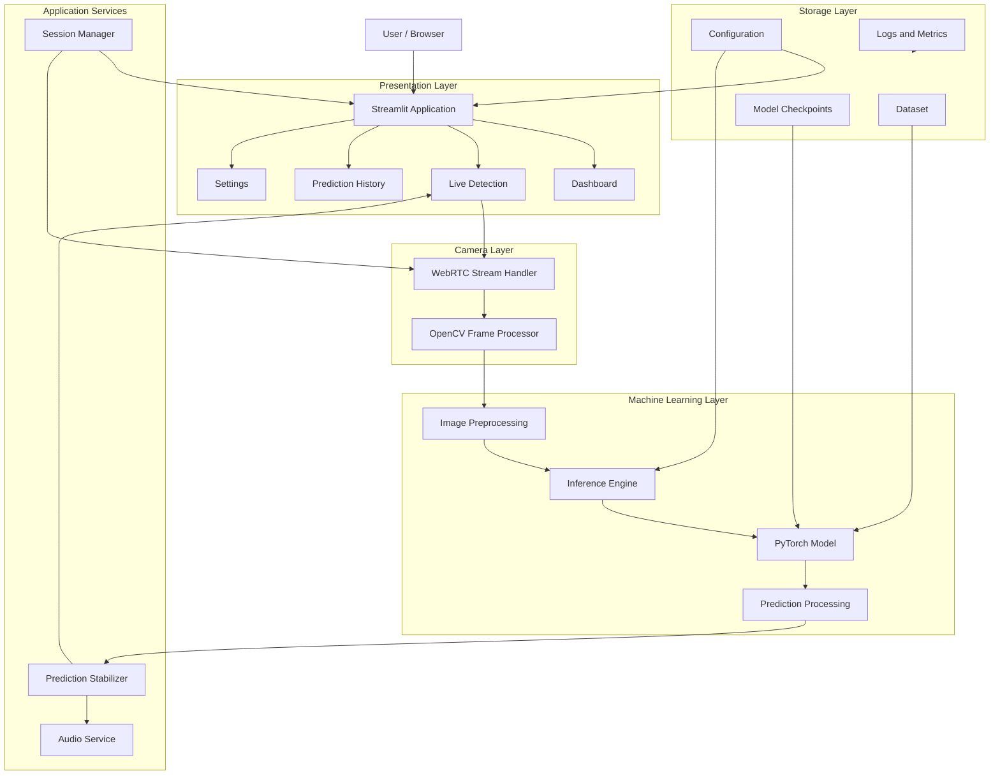
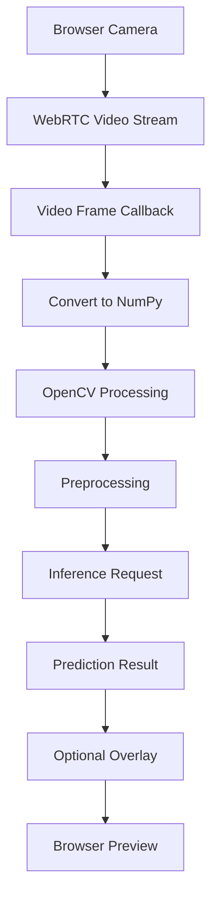
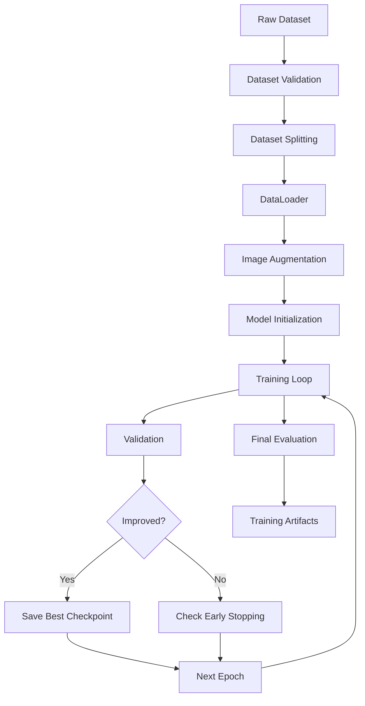
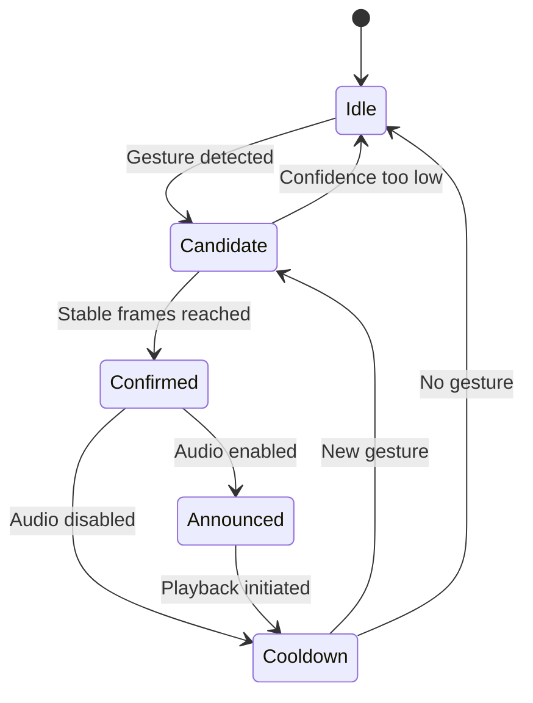
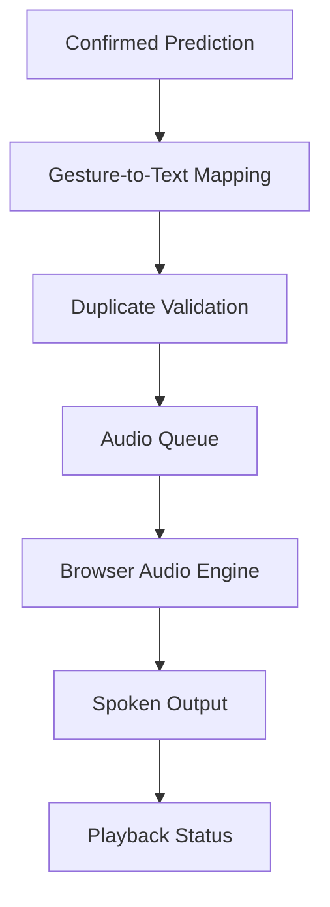

# System Architecture
# Real-Time Gesture Recognition and Audio Assistant

**Project:** Gesture Recognition and Audio Assistant  
**Version:** 1.0.0  
**Architecture Style:** Modular, Layered, Component-Based Architecture  
**Frontend:** Streamlit  
**Backend:** Python  
**Machine Learning:** PyTorch  
**Computer Vision:** OpenCV  
**Camera Streaming:** streamlit-webrtc  
**Audio:** Browser Speech Synthesis / Audio Playback  
**Environment Manager:** uv  
**Environment Directory:** `venv/`

---

# 1. Architectural Overview

## 1.1 Purpose

This document defines the complete technical architecture of the Real-Time Gesture Recognition and Audio Assistant.

The system will use a trained PyTorch model to recognize hand gestures from live camera frames and convert stable predictions into spoken audio.

The architecture must maintain strict separation between:

- User interface.
- Camera streaming.
- Computer vision.
- Image preprocessing.
- Machine learning training.
- Model evaluation.
- Model inference.
- Prediction stabilization.
- Audio processing.
- Application state management.
- Data and artifact management.

The system must be modular enough to allow individual components to be replaced without requiring changes throughout the application.

## 1.2 Architectural Principles

The following principles are mandatory.

1. Separation of concerns.
2. Single responsibility for each module.
3. Reusable and testable components.
4. Independent model training and inference.
5. Centralized configuration management.
6. Consistent preprocessing across training and inference.
7. Thread-safe model access.
8. Session-isolated user state.
9. Controlled resource allocation.
10. Explicit error handling.
11. Reproducible ML experiments.
12. No unnecessary abstraction or framework dependencies.

---

# 2. High-Level System Architecture

The application consists of seven primary layers.



## 2.1 Layer Responsibilities

| Layer | Responsibility |
|---|---|
| Presentation | User interface and interaction |
| Camera | Browser camera streaming and frame acquisition |
| Computer Vision | Frame processing and image transformation |
| ML | Model architecture, loading and inference |
| Application Services | Prediction stabilization, audio and session management |
| Storage | Dataset, checkpoints, configurations and logs |
| Training | Independent model training and evaluation |

The training pipeline is an offline development process. It must not be part of the live inference execution path.

---

# 3. Complete Project Structure

The following structure is the authoritative project layout.

```text
gesture-recognition/
│
├── app.py
├── requirements.txt
├── pyproject.toml
├── uv.lock
├── .python-version
├── .gitignore
├── README.md
├── config.yaml
│
├── pages/
│   ├── 01_Dashboard.py
│   ├── 02_Live_Detection.py
│   ├── 03_Prediction_History.py
│   ├── 04_Model_Information.py
│   └── 05_Settings.py
│
├── components/
│   ├── __init__.py
│   ├── sidebar.py
│   ├── navbar.py
│   ├── cards.py
│   ├── charts.py
│   ├── camera_view.py
│   ├── prediction_view.py
│   └── audio_controls.py
│
├── train/
│   ├── __init__.py
│   ├── train.py
│   ├── trainer.py
│   ├── loss.py
│   ├── optimizer.py
│   ├── scheduler.py
│   └── callbacks.py
│
├── test/
│   ├── __init__.py
│   ├── test_model.py
│   ├── test_dataset.py
│   ├── test_inference.py
│   ├── test_preprocessing.py
│   └── test_camera.py
│
├── model/
│   ├── __init__.py
│   ├── architecture.py
│   ├── classifier.py
│   ├── model_loader.py
│   ├── inference.py
│   ├── checkpoint.py
│   ├── weights/
│   │   └── .gitkeep
│   └── exports/
│       └── .gitkeep
│
├── server/
│   ├── __init__.py
│   ├── camera_server.py
│   ├── stream_handler.py
│   ├── prediction_service.py
│   ├── audio_service.py
│   └── session_manager.py
│
├── data/
│   ├── raw/
│   ├── processed/
│   ├── splits/
│   │   ├── train.csv
│   │   ├── validation.csv
│   │   └── test.csv
│   └── dataset.py
│
├── utils/
│   ├── __init__.py
│   ├── preprocessing.py
│   ├── augmentation.py
│   ├── metrics.py
│   ├── visualization.py
│   ├── device.py
│   ├── logging.py
│   └── reproducibility.py
│
├── assets/
│   ├── images/
│   ├── icons/
│   └── audio/
│
├── outputs/
│   ├── checkpoints/
│   ├── logs/
│   ├── metrics/
│   ├── plots/
│   └── predictions/
│
├── scripts/
│   ├── collect_data.py
│   ├── preprocess_data.py
│   ├── evaluate.py
│   └── export_model.py
│
├── docs/
│   ├── architecture.md
│   ├── dataset.md
│   ├── training.md
│   └── deployment.md
│
└── venv/
```

**Important:** `venv/` is generated locally and must be excluded from version control.

The directories under `outputs/`, `data/processed/` and model storage are generated or runtime-managed directories. They should not be committed indiscriminately.

---

# 4. Application Entry Point

## 4.1 app.py

`app.py` is the main entry point.

Its responsibilities are limited to:

1. Initializing Streamlit.
2. Loading application configuration.
3. Initializing application services.
4. Initializing session state.
5. Configuring navigation.
6. Rendering the selected page.

It must not contain:

- Model architecture definitions.
- Training loops.
- Camera-processing algorithms.
- Image preprocessing implementations.
- Audio-processing implementations.
- Large business logic functions.

Expected application initialization flow:

```text
Application Start
       |
       v
Load Configuration
       |
       v
Initialize Logging
       |
       v
Initialize Session State
       |
       v
Initialize Shared Model Resource
       |
       v
Configure Navigation
       |
       v
Render Selected Page
```

The model should be loaded lazily when needed rather than loading it repeatedly on every Streamlit rerun.

---

# 5. Presentation Layer

Location: `pages/` and `components/`

## 5.1 Pages

Each page must have one clear responsibility.

### Dashboard

File: `pages/01_Dashboard.py`

Displays:

- Model status.
- Model architecture.
- Number of supported gestures.
- Latest predictions.
- Detection statistics.
- Model evaluation metrics.
- Application status.

### Live Detection

File: `pages/02_Live_Detection.py`

Provides:

- Camera access.
- Live camera preview.
- Start/stop detection.
- Real-time predictions.
- Confidence scores.
- Audio controls.
- Prediction history.

This is the primary functional page.

### Prediction History

File: `pages/03_Prediction_History.py`

Displays session prediction records.

Each record should contain:

- Prediction ID.
- Gesture class.
- Confidence.
- Timestamp.
- Audio status.

### Model Information

File: `pages/04_Model_Information.py`

Displays actual model metadata.

### Settings

File: `pages/05_Settings.py`

Manages user-adjustable detection and audio preferences.

## 5.2 Reusable Components

The `components/` directory must contain reusable UI elements.

Components must not directly implement model inference or camera acquisition.

They should receive data and callbacks from the appropriate application service.

This avoids coupling UI components with the ML implementation.

---

# 6. Camera Streaming Architecture

Location: `server/`

## 6.1 Camera Technology

Use:

- `streamlit-webrtc`
- OpenCV
- NumPy

Browser camera access must be handled through WebRTC.

Do not assume that `cv2.VideoCapture(0)` accesses the browser user's camera. It accesses a camera available to the Python host.

## 6.2 camera_server.py

Responsibilities:

- Initialize camera streaming configuration.
- Configure WebRTC settings.
- Manage stream startup.
- Manage stream shutdown.
- Expose camera status.
- Handle connection failures.

## 6.3 stream_handler.py

Responsibilities:

- Receive incoming video frames.
- Convert frames to NumPy arrays.
- Pass frames into the computer vision pipeline.
- Return processed frames when overlays are required.

The frame callback must remain lightweight.

It must not:

- Call Streamlit UI functions.
- Load model weights.
- Perform model training.
- Block waiting for audio.
- Create unlimited background threads.

## 6.4 Frame Processing Pipeline



## 6.5 Frame Rate Management

The application must not assume that every incoming frame needs to be classified.

Introduce configurable frame sampling.

For example:

- Camera preview: process available incoming frames.
- Model inference: process selected frames according to available compute capacity.
- UI updates: publish only meaningful prediction changes.

The inference rate must be measured on actual hardware.

---

# 7. Computer Vision Architecture

Location: `utils/preprocessing.py`

The computer vision pipeline is responsible for converting camera frames into model-compatible inputs.

## 7.1 Preprocessing Steps

```text
Incoming Frame
      |
      v
Validate Frame
      |
      v
BGR to RGB
      |
      v
Resize to 224 x 224
      |
      v
Convert to Tensor
      |
      v
Normalize
      |
      v
Pass to Model
```

## 7.2 Preprocessing Consistency

Training and inference must use compatible preprocessing.

The preprocessing configuration must be shared.

For example:

```yaml
preprocessing:
  input_width: 224
  input_height: 224
  color_space: RGB
  interpolation: bilinear
  normalization: imagenet
  mean:
    - 0.485
    - 0.456
    - 0.406
  std:
    - 0.229
    - 0.224
    - 0.225
```

Do not independently implement different normalization values in training and inference.

The application must reject invalid or empty frames gracefully.

---

# 8. Machine Learning Architecture

Location: `model/`

The model layer is responsible for architecture construction, checkpoint loading and inference.

## 8.1 architecture.py

Contains the PyTorch model architecture.

Initial architecture:

- VGG16.
- Pretrained weights when available.
- Custom classification head.
- Configurable output classes.

The model must be initialized through a factory function.

Conceptual interface:

```python
def build_model(
    architecture: str,
    num_classes: int,
    pretrained: bool = True,
):
    ...
```

The architecture factory should support future model implementations without changing the inference service.

## 8.2 classifier.py

Responsible for:

- Model configuration.
- Model initialization.
- Classification head configuration.
- Model metadata.

## 8.3 model_loader.py

Responsible for:

- Resolving checkpoint paths.
- Loading checkpoint metadata.
- Validating architecture compatibility.
- Loading model parameters.
- Moving the model to the selected device.
- Setting evaluation mode.

The loader must use safe checkpoint-loading practices.

Never load an untrusted pickle-based checkpoint.

## 8.4 checkpoint.py

Responsible for:

- Saving model state.
- Loading model state.
- Saving optimizer state.
- Saving training progress.
- Tracking best validation checkpoints.
- Managing checkpoint metadata.

## 8.5 inference.py

The inference engine exposes a clean interface to the rest of the application.

Expected interface:

```python
class InferenceEngine:

    def load_model(self):
        ...

    def predict(self, image):
        ...

    def get_model_info(self):
        ...

    def release(self):
        ...
```

The prediction function should return structured information:

```python
{
    "class_id": 0,
    "class_name": "HELLO",
    "confidence": 0.96,
    "probabilities": {},
    "inference_time_ms": 12.5
}
```

The values above are illustrative, not measured performance.

All predictions must run in evaluation mode and under `torch.inference_mode()`.

---

# 9. Training Architecture

Location: `train/`

Training must operate independently from the Streamlit application.

## 9.1 Training Pipeline



## 9.2 train.py

Acts as the training command entry point.

Responsibilities:

- Load configuration.
- Initialize reproducibility settings.
- Initialize dataset.
- Initialize model.
- Initialize optimizer and scheduler.
- Start training.

## 9.3 trainer.py

Contains the training loop.

Responsibilities:

- Batch iteration.
- Forward propagation.
- Loss computation.
- Backpropagation.
- Gradient updates.
- Validation.
- Checkpointing.
- Metric recording.

## 9.4 loss.py

Contains configurable loss functions.

Initial choice:

`CrossEntropyLoss`

Future support:

- Weighted cross-entropy.
- Focal loss.

## 9.5 optimizer.py

Responsible for optimizer construction.

Initial choice:

`AdamW`

## 9.6 scheduler.py

Responsible for learning-rate scheduling.

Initial options:

- ReduceLROnPlateau.
- CosineAnnealingLR.

## 9.7 callbacks.py

Contains reusable training callbacks:

- Early stopping.
- Best checkpoint selection.
- Training progress logging.
- Metric tracking.

---

# 10. Dataset Architecture

Location: `data/`

## 10.1 Dataset Organization

Raw images must be stored separately from processed images.

```text
data/
│
├── raw/
│   ├── HELLO/
│   ├── YES/
│   ├── NO/
│   ├── THANK_YOU/
│   ├── PLEASE/
│   ├── STOP/
│   ├── HELP/
│   ├── GOOD/
│   ├── BAD/
│   ├── LOVE/
│   └── NONE/
│
├── processed/
│
├── splits/
│   ├── train.csv
│   ├── validation.csv
│   └── test.csv
│
└── dataset.py
```

## 10.2 dataset.py

Responsibilities:

- Dataset initialization.
- Image loading.
- Label mapping.
- Transform application.
- Invalid sample handling.
- Dataset statistics.

Use PyTorch `Dataset` and `DataLoader`.

## 10.3 Dataset Leakage Prevention

Splitting must be performed at an appropriate recording-session or participant level.

Near-identical frames from a single recording must not appear in both training and test sets.

## 10.4 Unknown Gesture Handling

A softmax classifier always distributes probability across its known classes.

A high confidence score does not prove that an input belongs to a supported gesture.

Therefore:

- Include diverse negative samples.
- Train a `NONE` class where appropriate.
- Validate unknown gestures separately.
- Calibrate the confidence threshold.
- Consider out-of-distribution detection in future versions.

---

# 11. Prediction Processing Architecture

Location: `server/prediction_service.py`

The prediction service converts raw model outputs into stable application-level predictions.

## 11.1 Responsibilities

- Receive inference results.
- Validate confidence.
- Apply temporal smoothing.
- Confirm repeated predictions.
- Detect prediction transitions.
- Apply cooldown.
- Publish stable results.

## 11.2 Prediction State Machine



## 11.3 Prediction Stabilization

Configuration:

```yaml
detection:
  confidence_threshold: 0.85
  confirmation_frames: 5
  smoothing_window: 5
  cooldown_seconds: 1.5
```

Implementation should maintain a bounded prediction window.

The same gesture must not be announced repeatedly while the hand remains in the same position.

A new announcement should occur only after an appropriate state transition or re-arm condition.

---

# 12. Audio Architecture

Location: `server/audio_service.py`

The audio service is responsible for converting confirmed gesture predictions into spoken output.

## 12.1 Audio Flow



## 12.2 Audio Technology

Use browser-side speech synthesis where supported.

Alternatively, prerecorded audio assets can be used for each gesture.

The Python server should not block while waiting for audio playback.

## 12.3 Audio Service Responsibilities

- Receive stable prediction events.
- Convert gesture labels into text.
- Manage duplicate prevention.
- Maintain a bounded playback queue.
- Trigger browser-side playback.
- Track playback state.
- Handle audio failures.

## 12.4 Gesture Mapping

Example:

```python
GESTURE_TEXT = {
    "HELLO": "Hello",
    "YES": "Yes",
    "NO": "No",
    "THANK_YOU": "Thank you",
    "PLEASE": "Please",
    "STOP": "Stop",
    "HELP": "Help",
    "GOOD": "Good",
    "BAD": "Bad",
    "LOVE": "Love",
}
```

The mapping must be maintained in one centralized location.

## 12.5 Important Browser Limitation

Browser speech synthesis is controlled by the client browser.

Autoplay restrictions may require the user to interact with the application before audio playback becomes available.

The application must provide an explicit audio-enable action and a fallback for unsupported browsers.

A Streamlit Python process cannot directly control the visitor's physical speakers.

---

# 13. Session Management Architecture

Location: `server/session_manager.py`

Streamlit maintains separate browser sessions, while certain cached resources may be shared across users.

These two forms of state must not be confused.

## 13.1 Session-Specific State

Each session should maintain:

- Camera connection status.
- Detection enabled status.
- Audio enabled status.
- Latest prediction.
- Prediction history.
- Prediction stabilization buffer.
- User settings.

## 13.2 Shared Resources

Potential shared resources:

- Read-only model instance.
- Immutable class mappings.
- Application configuration.

Use `st.cache_resource` for suitable shared resources such as the loaded model.

However, a globally shared PyTorch model must not contain mutable per-session prediction state.

Protect shared inference operations where necessary, particularly when multiple camera callbacks may access the same GPU model.

If inference becomes a concurrency bottleneck, introduce a centralized inference worker with a bounded request queue.

## 13.3 Session Lifecycle

```text
Session Created
      |
      v
Initialize Session State
      |
      v
User Starts Camera
      |
      v
Create WebRTC Stream
      |
      v
Receive Frames
      |
      v
Run Inference
      |
      v
Publish Predictions
      |
      v
User Stops Camera
      |
      v
Release Stream Resources
      |
      v
Session Ends
```

All camera streams and session-specific resources must have explicit cleanup behavior.

---

# 14. Storage Architecture

## 14.1 Storage Responsibilities

| Location | Content |
|---|---|
| data/raw | Original images |
| data/processed | Processed datasets |
| data/splits | Dataset manifests |
| model/weights | Versioned model weights |
| model/exports | Deployment model exports |
| outputs/checkpoints | Training checkpoints |
| outputs/logs | Training and application logs |
| outputs/metrics | Evaluation results |
| outputs/plots | Training visualizations |
| outputs/predictions | Optional prediction exports |

Avoid saving every camera frame during normal operation.

Camera frames should be transient unless explicit dataset collection is enabled.

## 14.2 Model Metadata

Each checkpoint should have associated metadata.

Example:

```json
{
  "model_name": "gesture_classifier",
  "architecture": "vgg16",
  "version": "1.0.0",
  "num_classes": 12,
  "input_size": [224, 224],
  "color_space": "RGB",
  "normalization": "imagenet",
  "checkpoint": "best_model.pth"
}
```

The class mapping and preprocessing configuration must also be versioned with the checkpoint.

The model loader must reject incompatible metadata rather than silently loading an incompatible model.

---

# 15. Configuration Architecture

Location: `config.yaml`

All frequently adjusted application parameters must be centralized.

Example:

```yaml
app:
  name: Gesture Recognition Assistant
  version: 1.0.0
  environment: development

model:
  architecture: vgg16
  checkpoint: outputs/checkpoints/best_model.pth
  input_width: 224
  input_height: 224
  num_classes: 12

device:
  preference: auto

camera:
  enabled: true
  target_fps: 20
  frame_skip: 2

detection:
  confidence_threshold: 0.85
  confirmation_frames: 5
  smoothing_window: 5
  cooldown_seconds: 1.5

audio:
  enabled: true
  autoplay_after_user_activation: true
  duplicate_prevention: true

training:
  epochs: 50
  batch_size: 32
  learning_rate: 0.0001
  optimizer: adamw
  seed: 42

logging:
  level: INFO
  save_to_file: true
```

Configuration validation must occur during application initialization.

Invalid settings must produce clear errors.

The number of classes should ultimately be derived from the versioned class mapping, not maintained independently in multiple places.

---

# 16. Device Management

Location: `utils/device.py`

The system must support:

- CUDA GPU.
- CPU fallback.

Device selection:

```text
Application Starts
       |
       v
Check CUDA Availability
       |
       +---- Available ----> Initialize CUDA
       |
       +---- Unavailable --> Initialize CPU
       |
       v
Load Model
       |
       v
Set Evaluation Mode
```

The application must not assume CUDA is available simply because a GPU is physically installed.

Device compatibility must be tested against the installed PyTorch and NVIDIA driver versions.

GPU memory usage should be monitored during development.

---

# 17. Error Handling Architecture

Errors must be handled at the appropriate module boundaries.

| Error | Expected behavior |
|---|---|
| Model checkpoint missing | Display model unavailable |
| Invalid checkpoint | Reject loading |
| Camera permission denied | Display permission guidance |
| Camera disconnected | Stop stream and display status |
| Invalid frame | Skip frame safely |
| CUDA unavailable | Use CPU fallback |
| Audio unavailable | Keep prediction functional |
| Unsupported gesture | Display unknown gesture |
| Inference failure | Log error and recover safely |
| Invalid configuration | Reject configuration |

The application must never crash silently or display fabricated predictions after an inference failure.

---

# 18. Performance Architecture

Performance optimization must be applied at every layer.

## 18.1 Model Performance

- Load the model once.
- Use `model.eval()`.
- Use `torch.inference_mode()`.
- Avoid unnecessary tensor conversions.
- Use the selected device consistently.
- Benchmark inference separately.

## 18.2 Camera Performance

- Process frames selectively.
- Avoid excessive image copies.
- Avoid blocking callbacks.
- Keep stream buffers bounded.
- Discard stale frames when the processing pipeline falls behind.

## 18.3 Streamlit Performance

- Use `st.cache_resource` for appropriate shared resources.
- Use `st.cache_data` for suitable data computations.
- Use Session State for session-specific state.
- Avoid unnecessary full-page reruns.
- Separate UI updates from camera callbacks.

## 18.4 Audio Performance

- Use asynchronous browser-side playback.
- Prevent repeated announcements.
- Bound the audio queue.
- Avoid blocking inference.

## 18.5 Multi-User Considerations

The initial deployment is intended for a small number of concurrent users.

Multiple users may share one model instance, but each user must have an independent camera stream and prediction state.

GPU contention must be benchmarked.

If multiple users exceed available inference capacity, move inference behind a centralized worker queue or a separate inference service.

Do not assume that increasing Streamlit worker processes will automatically improve GPU inference throughput.

---

# 19. API and Module Contracts

Although the initial implementation does not require a separate REST API, modules must communicate through explicit interfaces.

| Module | Input | Output |
|---|---|---|
| Camera server | Camera configuration | Stream status |
| Frame processor | Video frame | Processed frame |
| Preprocessing | Image | Tensor |
| Inference engine | Tensor | Raw prediction |
| Prediction service | Raw prediction | Stable prediction event |
| Audio service | Prediction event | Playback request |
| Session manager | Session events | Session state |
| Trainer | Dataset and config | Checkpoints and metrics |
| Evaluator | Checkpoint and test data | Evaluation report |

Use typed data structures for important boundaries.

Recommended contracts:

```python
@dataclass
class PredictionResult:
    class_id: int
    class_name: str
    confidence: float
    inference_time_ms: float


@dataclass
class StablePredictionEvent:
    class_name: str
    confidence: float
    timestamp: float
    event_id: str
```

These contracts should be expanded as the implementation develops.

---

# 20. Testing Architecture

Testing must be independent of the Streamlit presentation layer wherever possible.

## 20.1 Unit Tests

Test:

- Model construction.
- Model loading.
- Dataset loading.
- Preprocessing.
- Tensor dimensions.
- Inference outputs.
- Prediction stabilization.
- Gesture mapping.
- Configuration validation.

## 20.2 Integration Tests

Test:

- Camera to frame processing.
- Frame processing to inference.
- Inference to prediction service.
- Prediction service to audio event.
- Checkpoint loading.
- Session cleanup.

## 20.3 Performance Tests

Measure:

- Model initialization time.
- Inference latency.
- Camera-to-prediction latency.
- Frame processing throughput.
- GPU memory usage.
- CPU memory usage.
- Sustained session stability.

## 20.4 Hardware Tests

Test on:

- CPU-only environment.
- CUDA-enabled environment.
- Browser with camera permission.
- Browser without camera permission.
- Browser with audio restrictions.

Automated tests should use synthetic frames or test fixtures instead of requiring physical camera hardware.

---

# 21. Development and Execution Architecture

## 21.1 Environment Initialization

Use `uv` exclusively for environment and dependency management.

```bash
uv python pin 3.11

uv venv venv

source venv/bin/activate

uv add streamlit streamlit-webrtc opencv-python-headless numpy pillow pandas matplotlib scikit-learn pyyaml pytest

uv add torch torchvision

uv lock

uv sync --active
```

Install the appropriate PyTorch build for the target CUDA environment using the official PyTorch installation instructions.

Do not assume the default PyTorch package automatically matches the machine's GPU driver.

## 21.2 Training

```bash
uv run --active python -m train.train
```

## 21.3 Evaluation

```bash
uv run --active python scripts/evaluate.py
```

## 21.4 Testing

```bash
uv run --active pytest test/ -v
```

## 21.5 Application

```bash
uv run --active streamlit run app.py
```

Training, evaluation and application execution must remain independent processes.

---

# 22. Deployment Architecture

## 22.1 Local Deployment

Initial deployment:

```text
User Browser
     |
     v
Local Streamlit Server
     |
     v
Camera/WebRTC
     |
     v
OpenCV
     |
     v
PyTorch Inference
     |
     v
Audio Output
```

The browser accesses the locally running application.

## 22.2 Remote Deployment

For remote deployment:

```text
User Browser
     |
     v
HTTPS
     |
     v
Streamlit Server
     |
     v
WebRTC Connection
     |
     v
Inference Engine
     |
     v
Prediction Service
     |
     v
Browser Audio
```

Remote deployment requires additional consideration:

- HTTPS.
- WebRTC STUN/TURN configuration.
- Camera permission handling.
- Session isolation.
- Concurrent inference management.
- CPU/GPU capacity.
- Application monitoring.

A Streamlit server cannot directly access the remote user's webcam through its local OpenCV device interface.

WebRTC must be configured for the deployment network, and TURN infrastructure may be needed when direct peer connectivity is unavailable.

---

# 23. Future Architecture Extensions

The system must allow the following features to be added without redesigning the entire application.

## 23.1 Dynamic Gesture Recognition

The initial architecture is designed for static image classification.

Future dynamic recognition will require temporal sequences.

Possible architecture:

```text
Camera Frames
      |
      v
Hand Detection
      |
      v
Landmark Extraction
      |
      v
Temporal Sequence Buffer
      |
      v
LSTM / GRU / Transformer
      |
      v
Gesture Classification
      |
      v
Prediction Stabilization
      |
      v
Audio Output
```

## 23.2 Additional Model Architectures

Future model support:

- MobileNetV3.
- ResNet.
- EfficientNet.
- Vision Transformer.
- Custom CNN.
- Temporal Transformer.

## 23.3 Additional Features

- Multi-hand detection.
- Multi-language speech.
- Custom gesture training.
- Dataset collection interface.
- Gesture-to-sentence conversion.
- Prediction analytics.
- Model comparison.
- Model version management.
- Exportable reports.

---

# 24. Architecture Rules

These rules are mandatory.

1. `app.py` must remain lightweight.
2. UI components must not contain model inference implementations.
3. Training code must never be imported into the live inference execution path unnecessarily.
4. Model architecture must exist only in the model layer.
5. Dataset loading must remain independent of the Streamlit interface.
6. Training and inference must share compatible preprocessing.
7. Model weights must never be reloaded for every frame.
8. Camera callbacks must never call Streamlit rendering functions.
9. Camera processing must not wait for audio playback.
10. Prediction state must remain session-specific.
11. Shared model resources must be treated as read-only and concurrency-safe.
12. All queues and buffers must have defined limits.
13. All long-running resources must have cleanup procedures.
14. All important configuration values must be centralized.
15. Model metadata and class mappings must be versioned.
16. CPU fallback must always be supported.
17. Training metrics must be based on actual experiments.
18. Testing must not modify the original dataset.
19. Raw camera frames must not be persisted without explicit permission.
20. No unnecessary abstraction or external framework should be introduced.
21. Every module must have a clearly defined responsibility.
22. Every major component must be independently testable.

---

# 25. Definition of Done

The architecture is considered correctly implemented when:

- [ ] All modules follow the defined directory structure.
- [ ] Environment management uses uv.
- [ ] The virtual environment directory is named `venv`.
- [ ] Training executes independently.
- [ ] Testing executes independently.
- [ ] Model checkpoints contain required metadata.
- [ ] Inference works independently of Streamlit.
- [ ] Browser camera streaming works.
- [ ] OpenCV processes incoming frames.
- [ ] Predictions are stabilized.
- [ ] Audio runs independently of inference.
- [ ] Streamlit state is correctly isolated.
- [ ] Shared resources are concurrency-safe.
- [ ] Camera resources are released correctly.
- [ ] CPU and CUDA execution are supported.
- [ ] Application errors are handled properly.
- [ ] Performance can be measured.
- [ ] Documentation is complete.

---

# 26. Final Architectural Decision

The project will use a modular Python architecture with Streamlit as the presentation and application orchestration layer, WebRTC as the browser camera transport, OpenCV as the computer vision processing layer, and PyTorch as the machine learning and inference framework.

Training and testing will remain independent development pipelines.

The initial version will focus on static gesture recognition with stable prediction and audio output.

Future dynamic gesture recognition will be introduced through a separate temporal modeling pipeline.

**The primary engineering objective is not simply to make a camera detect gestures. It is to create a reliable, testable, extensible computer-vision application in which every subsystem has a clear responsibility and can evolve independently.**