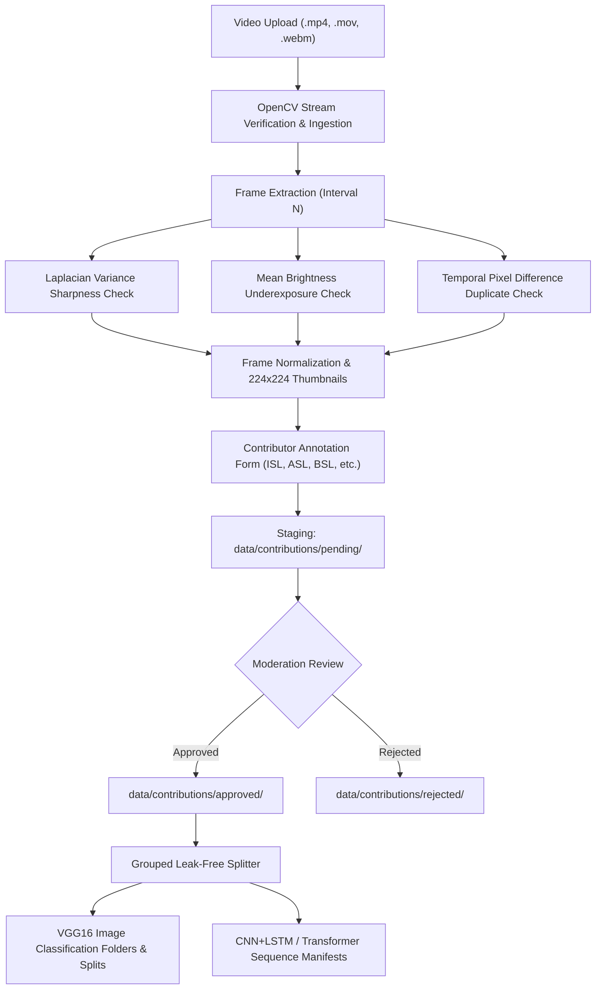

# Community Gesture Contribution Pipeline

## 1. Overview & Architecture

GESTURA's **Contribute a Gesture** pipeline provides an end-to-end computer vision and machine learning data collection system. It enables community contributors, sign language researchers, and educators to upload video recordings of sign language gestures (e.g., ISL, ASL, BSL). 

The system validates video integrity, extracts key frames at configurable intervals, performs automated Computer Vision (CV) quality audits (detecting blur, dark lighting, and near-identical duplicate frames), collects standardized multi-sign-language semantic annotations, and stages samples in a quarantined dataset structure ready for review and model training.



---

## 2. Dataset Storage Organization

To ensure strict data provenance and prevent unverified user uploads from corrupting trusted training data, contributed data is stored in dedicated, isolated hierarchies:

```
data/
├── raw/                              # Original trusted training dataset (immutable)
├── splits/                           # Train/val/test CSV manifests
└── contributions/                    # Dedicated community contribution repository
    ├── pending/                      # In-progress drafts & pending review
    │   └── contrib_<timestamp>_<id>/
    │       ├── original_video.mp4    # Ingested raw video
    │       ├── metadata.json         # Video parameters, semantics & review state
    │       └── frames/
    │           ├── frames_metadata.json
    │           ├── frame_0001.jpg    # Full-resolution frame
    │           ├── frame_0001_thumb.jpg # 224x224 RGB thumbnail
    │           └── ...
    ├── approved/                     # Reviewed and approved community samples
    └── rejected/                     # Flagged or rejected samples with reason
```

---

## 3. Computer Vision Quality Auditing

During frame extraction, each extracted frame is evaluated using OpenCV algorithms:

1. **Sharpness & Blur Detection**:
   $$\text{Variance}(\nabla^2 I) = \text{Var}(\text{Laplacian}(I_{\text{gray}}))$$
   Frames with variance $< 25.0$ are flagged as blurry and excluded by default.
2. **Exposure & Brightness Check**:
   $$\mu = \frac{1}{HW} \sum_{x,y} I_{\text{gray}}(x, y)$$
   Frames with $\mu < 15.0$ are flagged as dark/underexposed and marked as inactive.
3. **Temporal Redundancy / Duplicate Detection**:
   $$\Delta = \frac{1}{255 \cdot HW} \sum_{x,y} |I_{t}(x,y) - I_{t-1}(x,y)|$$
   Consecutive sampled frames with normalized absolute difference $\Delta < 0.02$ ($<2\%$ visual variance) are flagged as duplicates.
4. **Input Normalization**:
   For each extracted frame, an OpenCV bilinear resized $224 \times 224$ RGB companion thumbnail (`frame_XXXX_thumb.jpg`) is generated, exactly matching the spatial dimensions expected by the VGG16 model backbone.

---

## 4. REST API Specification

| Method | Endpoint | Description | Status Code |
| :--- | :--- | :--- | :--- |
| `POST` | `/contributions/upload` | Upload video file (`file: UploadFile`) | `201 Created` |
| `POST` | `/contributions/{id}/extract` | Configure sampling and extract frames | `200 OK` |
| `GET` | `/contributions/{id}` | Retrieve contribution metadata | `200 OK` |
| `GET` | `/contributions/{id}/frames` | Retrieve list of extracted frames and quality metrics | `200 OK` |
| `GET` | `/contributions/{id}/frames/{frame_id}` | Serve full-resolution frame JPEG | `200 OK` |
| `GET` | `/contributions/{id}/frames/{frame_id}/thumb` | Serve $224 \times 224$ normalized frame JPEG | `200 OK` |
| `DELETE` | `/contributions/{id}/frames/{frame_id}` | Exclude or remove a specific frame | `200 OK` |
| `POST` | `/contributions/{id}/submit` | Finalize metadata and submit for review | `200 OK` |
| `GET` | `/contributions` | List contributions (optional `?status=` filter) | `200 OK` |
| `POST` | `/contributions/{id}/review` | Moderate contribution (`approved: bool`) | `200 OK` |

---

## 5. Machine Learning Integration & Leak-Free Splitting

### The Video-to-Frame Data Leakage Problem
When training computer vision models on video frames, performing a random shuffle of all frames across train and validation sets leads to severe **data leakage** and inflated test performance: nearly identical frames from the same video recording appear in both training and test sets.

### Solution: Grouped Contribution Splitting
The `GroupedContributionSplitter` implemented in `data/contribution_dataset.py` groups samples strictly by `contribution_id`. All frames from a given video sample remain in the exact same partition:
- **Train Split (70%)**
- **Validation Split (15%)**
- **Test Split (15%)**

### Multi-Architecture Model Compatibility
- **Current VGG16 Model (Spatial 2D CNN)**:
  Single frames are exported to class folders (`<dest>/<GESTURE_NAME>/<cid>_<fid>.jpg`) and listed in stratified split CSVs (`image_path,class_id,class_name`).
- **Future Sequential Models (CNN+LSTM, Video Transformers)**:
  `scripts/export_contributions.py` exports `sequence_manifest.json` preserving video groupings, sequence ordering, frame indices, and millisecond timestamps.

---

## 6. Export CLI Script (`scripts/export_contributions.py`)

To export approved contributions into training dataset formats:

```bash
# Export approved contributions to image folders and split manifests
python scripts/export_contributions.py \
    --contributions-dir data/contributions \
    --dest-raw data/contributions/dataset \
    --splits-dir data/splits/contributions \
    --manifest-out data/contributions/sequence_manifest.json \
    --split-ratios 0.70 0.15 0.15 \
    --use-thumbnails
```

Optional flags:
- `--merge-with-existing-splits <path>`: Merges newly split samples with existing `data/splits/*.csv` manifests without deleting existing samples.
- `--seed 42`: Sets deterministic random seed for reproducible split allocations.

---

## 7. Frontend User Experience (`/contribute`)

The frontend is available at `/contribute` and adheres strictly to GESTURA's visual identity:
- **Visual Identity**: Electric Yellow (`#F5E642`), Deep Black (`#0B0B0B`), Elevated Surfaces (`#171717`, `#202020`), Space Grotesk typography, JetBrains Mono telemetry.
- **Section 1: Video Ingestion**: Drag-and-drop video upload zone with real-time video player preview, format checking, and resolution/duration telemetry.
- **Section 2: Frame Extraction Controls**: Live sampling interval slider and max frame limit with instant re-extraction and CV quality audit.
- **Section 3: Frame Inspection Grid**: Visual grid displaying extracted frames, sharpness metrics, blur badges, and single-frame exclusion actions. Includes full-screen modal zoom for fine-grained inspection.
- **Section 4: Semantic Annotation Form**: Form fields for Gesture Label, Meaning / Translation, Sign Language dialect (ISL, ASL, BSL, etc.), Category, and Static vs Dynamic gesture motion hint.
- **Section 5: Submission & Moderation**: Live validation (requiring $\ge 3$ active frames) and submission status tracking.
- **Browse Dataset Tab**: Search and filter community contributions by status (`pending_approval`, `approved`, `rejected`) with one-click review moderation controls.

