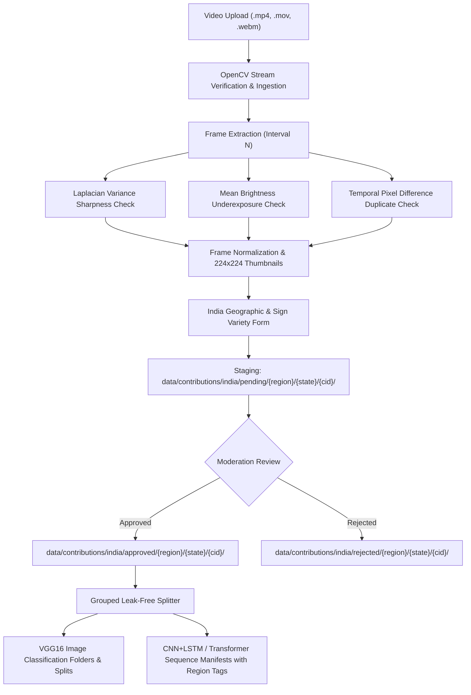

# India-First Gesture Contribution Pipeline

## 1. Overview & Architecture

GESTURA's **Community Gesture Contribution** system follows an **India-first dataset strategy**. In this phase, the pipeline focuses exclusively on Indian Sign Language (ISL) and its diverse regional community varieties across India.

The system captures rigorous geographic provenance following the hierarchy:
$$\text{Country (India)} \longrightarrow \text{Region} \longrightarrow \text{State / UT} \longrightarrow \text{District / City} \longrightarrow \text{Sign Language Variety} \longrightarrow \text{Gesture}$$



---

## 2. Geographic Hierarchy & Region Classification

The contribution system enforces 6 official Indian geographic regions covering all 28 states and 8 union territories:

| Region | States and Union Territories Included |
| :--- | :--- |
| **NORTH** | Delhi, Chandigarh, Haryana, Himachal Pradesh, Jammu and Kashmir, Ladakh, Punjab, Rajasthan, Uttarakhand, Uttar Pradesh |
| **SOUTH** | Andhra Pradesh, Karnataka, Kerala, Tamil Nadu, Telangana, Puducherry, Lakshadweep |
| **EAST** | Bihar, Jharkhand, Odisha, West Bengal |
| **WEST** | Goa, Gujarat, Maharashtra, Dadra and Nagar Haveli and Daman and Diu |
| **CENTRAL** | Chhattisgarh, Madhya Pradesh |
| **NORTHEAST** | Arunachal Pradesh, Assam, Manipur, Meghalaya, Mizoram, Nagaland, Sikkim, Tripura |

---

## 3. Sign Language Classification & Linguistic Ethics

The system provides 5 sign language classifications:
- **`Indian Sign Language (ISL)`**: Standardized pan-Indian sign language.
- **`Regional ISL Variant`**: Regional dialect (requires entering the regional variety name, e.g., "Delhi ISL", "Bengaluru Variety").
- **`Local Community Sign Language`**: Distinct deaf community or indigenous sign system (requires entering community/variety name, e.g., "Alipur Sign Language", "Naga Community Signs").
- **`Other`**: Distinct sign system (requires description).
- **`Unsure`**: Contributor is unsure of dialectal boundaries.

> [!IMPORTANT]
> **Ethical Principle**: Never automatically infer sign language identity from a contributor's state or spoken language. Sign languages in India possess distinct linguistic structures that do not map directly to spoken vernaculars.

---

## 4. Dataset Storage Organization

Contributed data is stored in isolated hierarchies under `data/contributions/india/`:

```
data/
├── raw/                                      # Original trusted training dataset (immutable)
├── splits/                                   # Train/val/test CSV manifests
└── contributions/
    └── india/                                # India-first contribution repository
        ├── pending/                          # Quarantined submissions awaiting review
        │   ├── _drafts/<cid>/                # Temporary staging prior to annotation form submission
        │   └── <region_slug>/<state_slug>/<cid>/
        │       ├── original_video.mp4        # Ingested raw video
        │       ├── metadata.json             # Geographic, linguistic, and review metadata
        │       └── frames/
        │           ├── frames_metadata.json
        │           ├── frame_0001.jpg        # Full-resolution frame
        │           ├── frame_0001_thumb.jpg  # 224x224 RGB thumbnail
        │           └── ...
        ├── approved/                         # Reviewed and promoted community samples
        │   └── <region_slug>/<state_slug>/<cid>/
        └── rejected/                         # Rejected samples with audit reasons
            └── <region_slug>/<state_slug>/<cid>/
```

---

## 5. Computer Vision Quality Auditing

During frame extraction, each extracted frame is evaluated using OpenCV algorithms:

1. **Sharpness & Blur Detection**:
   $$\text{Variance}(\nabla^2 I) = \text{Var}(\text{Laplacian}(I_{\text{gray}}))$$
   Frames with variance $< 25.0$ are flagged as blurry and excluded by default.
2. **Exposure & Brightness Check**:
   $$\mu = \frac{1}{HW} \sum_{x,y} I_{\text{gray}}(x, y)$$
   Frames with $\mu < 15.0$ are flagged as dark/underexposed and marked as inactive.
3. **Temporal Redundancy / Duplicate Detection**:
   $$\Delta = \frac{1}{255 \cdot HW} \sum_{x,y} |I_{t}(x,y) - I_{t-1}(x,y)|$$
   Consecutive sampled frames with normalized absolute difference $\Delta < 0.02$ ($<2\%$ visual variance) are flagged as duplicates.
4. **Input Normalization**:
   For each extracted frame, an OpenCV bilinear resized $224 \times 224$ RGB companion thumbnail (`frame_XXXX_thumb.jpg`) is generated, exactly matching the spatial dimensions expected by the VGG16 model backbone.

---

## 6. Machine Learning Considerations & Leak-Free Splitting

### Preventing Cross-Community Gesture Conflation
The gesture "Hello" or "Namaste" may have different visual representations across different communities in India. The `GroupedContributionSplitter` supports `stratify_by_variety=True` using qualified regional labels:
$$\text{qualified\_label} = \text{gesture\_name}\_\_\text{region}\_\_\text{variety}$$

### Zero Frame Leakage
Frames from the same video recording are **never** partitioned across train and validation splits:
- **Train Split (70%)**
- **Validation Split (15%)**
- **Test Split (15%)**

### Model Compatibility
- **Current VGG16 Model (Spatial 2D CNN)**: Single frames exported with regional columns (`image_path,class_id,class_name,country,region,state,district_city,sign_language_type,variety_name`).
- **Sequential Models (CNN+LSTM, Video Transformers)**: `scripts/export_contributions.py` exports `sequence_manifest.json` preserving video grouping, chronological frame indices, timestamps, and regional provenance.

---

## 7. Export CLI Usage (`scripts/export_contributions.py`)

```bash
# Export approved India contributions preserving regional metadata
python scripts/export_contributions.py \
    --contributions-dir data/contributions/india \
    --dest-raw data/contributions/india/dataset \
    --splits-dir data/splits/contributions/india \
    --manifest-out data/contributions/india/sequence_manifest.json \
    --split-ratios 0.70 0.15 0.15 \
    --use-thumbnails \
    --preserve-regional-folders
```

---

## 8. Frontend User Experience (`/contribute`)

The frontend is available at `/contribute` and adheres strictly to GESTURA's visual identity:
- **Fixed Country**: Fixed to India with a dedicated India-first badge.
- **Region Dropdown**: NORTH, SOUTH, EAST, WEST, CENTRAL, NORTHEAST.
- **State/UT Dropdown**: Dynamically filtered by selected region.
- **District/City**: Optional text field.
- **Sign Language Variety Selector**: Indian Sign Language (ISL), Regional ISL Variant, Local Community Sign Language, Other, Unsure.
- **Conditional Variety Input**: Dynamically displays variety/community name field when required.
- **Browse Tab**: Enables filtering community samples by Region and Status with full geographic tags.

---

## 9. Security, Authentication & Moderation Authorization

GESTURA enforces role-separated access boundaries to protect community contributor privacy and dataset integrity:

### 9.1 Public vs. Administrative Boundaries

| Category | Routes | Access Model | Data Sanitization |
| :--- | :--- | :--- | :--- |
| **Public Ingestion** | `/contributions/upload`, `/contributions/{id}/*` | Open / Contributor | Direct contributor workflow |
| **Public Dataset** | `/contributions/dataset/approved`, `/contributions/dataset/stats`, `/contributions/geo/*` | Open / Unauthenticated | Statically sanitized: strips `contributor_id`, raw video URLs, and server filesystem paths |
| **Administrative Moderation** | `GET /contributions`, `POST /contributions/{id}/review` | Admin Only (`X-Admin-Key`) | Full access to review queues, rejected entries, and unapproved samples |

### 9.2 Configuration & Constant-Time Verification

- **Environment Variable**: `GESTURA_ADMIN_TOKEN` must be set in the server environment.
- **Fail-Closed Guarantee**: If `GESTURA_ADMIN_TOKEN` is unset, empty, or contains only whitespace, all moderation endpoints immediately return `HTTP 503 Service Unavailable`. The system never defaults to open access.
- **Timing-Attack Resistance**: The `X-Admin-Key` header is verified against the configured token using `hmac.compare_digest` in constant time.
- **Status Codes**:
  - `503 Service Unavailable`: Server admin authentication is not configured (`GESTURA_ADMIN_TOKEN` is unset or empty).
  - `401 Unauthorized`: Request is missing the `X-Admin-Key` header.
  - `403 Forbidden`: Supplied `X-Admin-Key` does not match the configured secret.
  - `200 OK`: Successful moderation action or full contribution queue listing.

