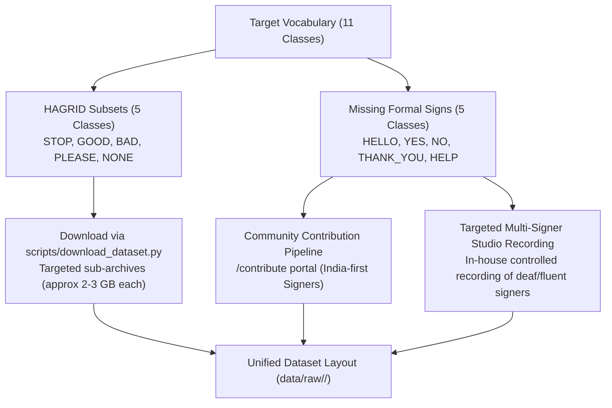

# GESTURA Dataset & Model Architecture Alignment Report

**Document Version:** 1.0.0  
**Status:** Architecture Proposal (Awaiting Approval Before Training)  
**Date:** October 31, 2026  
**Scope:** Dataset Audit, Target Vocabulary Alignment, Class Mapping Architecture, and Hand Detection Integration

---

## 1. Existing Dataset Inventory

A physical audit of the local repository was conducted across all potential data directories:

```
data/
├── raw/                  [DOES NOT EXIST]
├── processed/            [DOES NOT EXIST]
├── splits/               [DOES NOT EXIST]
└── contributions/        [EXISTS]
    ├── approved/         [0 production images]
    ├── pending/          [0 production images]
    ├── rejected/         [0 production images]
    └── india/            [Regional hierarchy initialized, 0 production images]

hagrid/
└── dataset/              [DOES NOT EXIST]
```

### Key Findings
1. **No Committed Image Data**: There are currently zero training or validation images stored in `data/raw/`, `data/processed/`, or `hagrid/dataset/`.
2. **No Data Split Manifests**: `data/splits/` is empty and contains no `train.csv`, `validation.csv`, or `test.csv` files.
3. **Contribution Pipeline Ready**: The infrastructure for crowd-sourced contributions exists under `data/contributions/` with regional India-first directory schemas (`north`, `south`, `east`, `west`, `northeast`, `central`), but no approved samples have been promoted to the primary training set yet.
4. **Synthetic Data Tooling**: `scripts/generate_synthetic_data.py` exists to generate simple synthetic geometric shapes for test harness verification, but cannot serve as genuine sign-language training data.

---

## 2. Actual Available Classes & Vocabulary Discrepancy

There is a significant architectural discrepancy between the different modules of the codebase regarding class definitions:

```
┌────────────────────────────────────────────────────────────────────────┐
│                          CLASS DEFINITIONS                             │
├──────────────────────────┬─────────────────────────────────────────────┤
│ config.yaml              │ 22 Classes (HAGRID/MultiMod subset):        │
│                          │ C, DOWN, FIST, FIVE, FOUR, HANG, HEAVY,    │
│                          │ INDEX, INDEX_LEFT, INDEX_RIGHT, LEFT, NONE, │
│                          │ OK, PALM, PALM_M, PALM_U, RIGHT, THREE,     │
│                          │ THUMBS_DOWN, THUMBS_UP, TWO, UP             │
├──────────────────────────┼─────────────────────────────────────────────┤
│ docs/dataset.md          │ 11 Classes (Core GESTURA Vocabulary):       │
│ & docs/prd.md            │ HELLO, YES, NO, THANK_YOU, PLEASE, STOP,    │
│                          │ HELP, GOOD, BAD, LOVE, NONE                 │
├──────────────────────────┼─────────────────────────────────────────────┤
│ server/audio_service.py  │ 10 Spoken Mappings:                         │
│                          │ HELLO, YES, NO, THANK_YOU, PLEASE, STOP,    │
│                          │ HELP, GOOD, BAD, LOVE (NONE unvoiced)       │
├──────────────────────────┼─────────────────────────────────────────────┤
│ train/train.py           │ Dynamic Discovery:                          │
│                          │ Reads `sorted(os.listdir("data/raw/"))`     │
│                          │ Overrides config.yaml mapping at runtime!   │
└──────────────────────────┴─────────────────────────────────────────────┘
```

### Risk Analysis
If training is run against `data/raw/` containing the 11 GESTURA classes, `train/train.py` dynamically creates an 11-class mapping (`BAD: 0, GOOD: 1, HELLO: 2, ...`). The resulting checkpoint will be **completely incompatible** with `config.yaml` (which expects 22 classes starting with `C: 0`), causing `_validate_metadata_compatibility` in `model/model_loader.py` to reject the checkpoint or produce scrambled class predictions.

---

## 3. Proposed Target Vocabulary (Phase 1)

For Phase 1 of GESTURA, we propose locking the target vocabulary to **11 canonical classes**: 10 expressive sign-language/conversational gestures plus 1 background/resting class (`NONE`).

```
┌───────────────────────────────────────────────────────────────────────────┐
│                    GESTURA PHASE 1 CANONICAL VOCABULARY                   │
├──────┬──────────────┬──────────────────┬───────────────────┬──────────────┤
│ ID   │ Class Name   │ Display Label    │ Spoken Text       │ Handedness   │
├──────┼──────────────┼──────────────────┼───────────────────┼──────────────┤
│ 0    │ HELLO        │ Hello / Greeting │ "Hello"           │ Single Hand  │
│ 1    │ YES          │ Yes / Agree      │ "Yes"             │ Single Hand  │
│ 2    │ NO           │ No / Disagree    │ "No"              │ Single Hand  │
│ 3    │ THANK_YOU    │ Thank You        │ "Thank you"       │ Single Hand  │
│ 4    │ PLEASE       │ Please / Request │ "Please"          │ Single/Two   │
│ 5    │ STOP         │ Stop / Halt      │ "Stop"            │ Single Hand  │
│ 6    │ HELP         │ Help / Assist    │ "Help"            │ Two Handed   │
│ 7    │ GOOD         │ Good / Like      │ "Good"            │ Single Hand  │
│ 8    │ BAD          │ Bad / Dislike    │ "Bad"             │ Single Hand  │
│ 9    │ LOVE         │ I Love You       │ "I love you"      │ Single/Two   │
│ 10   │ NONE         │ No Active Gesture│ [Silent]          │ -            │
└──────┴──────────────┴──────────────────┴───────────────────┴──────────────┘
```

---

## 4. Valid HAGRID-to-GESTURA Mappings

The HAGRID dataset contains 554,800 images across 33 gesture categories. However, HAGRID gestures were designed for human-computer interaction (e.g. video conferencing controls, camera commands), **not** natural sign language. 

Below is an objective semantic audit comparing GESTURA's vocabulary to HAGRID categories:

| GESTURA Class | Potential HAGRID Class | Visual Similarity | Semantic Validity | Mapping Verdict |
| :--- | :--- | :--- | :--- | :--- |
| **`STOP`** | `stop` | Exact (Open palm, fingers upright) | **Identical**: Universal stop gesture in both sign language and HCI. | **DIRECT MAP (VALID)** |
| **`GOOD`** | `like` | Exact (Thumb pointing upward) | **Valid Conversational Proxy**: Thumbs-up represents approval/good in informal sign and general culture. | **VALID PROXY** |
| **`BAD`** | `dislike` | Exact (Thumb pointing downward) | **Valid Conversational Proxy**: Thumbs-down represents disapproval/bad in informal sign and general culture. | **VALID PROXY** |
| **`PLEASE`** | `holy` | High (Palms pressed together) | **Valid for ISL**: Matches the Indian Sign Language (ISL) gesture for "Request / Please / Namaste". (Does not match ASL chest rub). | **VALID (ISL DIALECT)** |
| **`NONE`** | `no_gesture` | Exact (Hands resting / random postures) | **Identical**: Represents background, ambient hands, or non-gesture actions. | **DIRECT MAP (VALID)** |
| **`HELLO`** | `palm` | Moderate (Static open palm facing camera) | **Partial/Weak**: In sign language, "Hello" is a dynamic wave or temple salute. A static open palm is just `PALM`, not `HELLO`. | **PROXY WITH CAUTION** |
| **`YES`** | `fist` or `like` | Weak to Fist / Thumbs Up | **Invalid Formal Sign**: In ISL/ASL, "YES" is an S-fist nodding vertically. Static `fist` lacks movement; `like` is thumbs-up. | **REQUIRES CUSTOM DATA** |
| **`NO`** | `dislike` or `xsign` | Dislike / Crossed fingers | **Invalid Formal Sign**: In ISL/ASL, "NO" is index/middle tapping the thumb or index wagging horizontally. `dislike` is "Bad". | **REQUIRES CUSTOM DATA** |
| **`THANK_YOU`**| None | None in HAGRID | **NO EQUIVALENT**: Sign language "Thank You" requires fingertips to touch chin and move outward. HAGRID has no chin-touch poses. | **CUSTOM DATA MANDATORY** |
| **`HELP`** | None | None in HAGRID | **NO EQUIVALENT**: "Help" requires a thumbs-up fist placed on top of a flat open palm lifted upward. HAGRID has no such pose. | **CUSTOM DATA MANDATORY** |
| **`LOVE`** | `hand_heart` vs `rock` | Two hands forming heart | **Ambiguous**: `hand_heart` is universally understood as love. However, the official single-hand ILY sign (thumb, index, pinky extended) is **not** in HAGRID (`rock` folds the thumb). | **HYBRID: Use `hand_heart` or collect ILY** |

### Synthesis
- **Usable directly from HAGRID (5 classes)**: `STOP` (`stop`), `GOOD` (`like`), `BAD` (`dislike`), `PLEASE` (`holy`), `NONE` (`no_gesture`).
- **Requires Custom Sign-Language Collection (5 classes)**: `HELLO`, `YES`, `NO`, `THANK_YOU`, `HELP` (plus single-hand ILY `LOVE`).

---

## 5. Missing Gesture Data Acquisition Plan

To bridge the gap without fabricating data:



1. **HAGRID Targeted Download**: Use `scripts/download_dataset.py --targets stop like dislike holy no_gesture --max-images-per-class 1000` to download only the 5 valid categories, avoiding the 400 GB full archive.
2. **Community Gesture Contributions**: Direct contributor prompts on the `/contribute` portal specifically toward the missing classes: `THANK_YOU`, `HELP`, `YES`, `NO`, `HELLO`.
3. **Controlled Signer Recording Session**: Record 5–10 distinct participants performing the missing classes under varied lighting, backgrounds, and angles.

---

## 6. Recommended Dataset Structure & Signer-Independent Splitting

### 6.1 Directory Layout
```
data/
├── raw/
│   ├── HELLO/
│   │   ├── signer01_session01_0001.jpg
│   │   └── ...
│   ├── YES/
│   ├── NO/
│   ├── THANK_YOU/
│   ├── PLEASE/
│   ├── STOP/
│   ├── HELP/
│   ├── GOOD/
│   ├── BAD/
│   ├── LOVE/
│   └── NONE/
├── metadata/
│   └── samples.jsonl         # Detailed per-image metadata (signer, source, bbox)
└── splits/
    ├── train.csv             # 70% of signers
    ├── validation.csv        # 15% of signers
    └── test.csv              # 15% of signers
```

### 6.2 Signer-Independent Splitting Strategy (Critical Quality Requirement)
**The Problem:** Shuffling individual frames across splits causes the model to memorize the signer's identity, clothes, room, and lighting rather than the hand gesture. When evaluated on a new user, accuracy collapses.

**The Solution:** All splits must be partitioned at the **Signer / Video Session level** using `GroupKFold` or `GroupedContributionSplitter`:

$$\text{Signers}(S_{\text{train}}) \cap \text{Signers}(S_{\text{val}}) = \emptyset, \quad \text{Signers}(S_{\text{train}}) \cap \text{Signers}(S_{\text{test}}) = \emptyset$$

- If 10 signers participate: 7 signers $\to$ Train, 1–2 signers $\to$ Validation, 1–2 signers $\to$ Test.
- For HAGRID images: HAGRID filenames embed a unique user hash (`<user_hash>_<class>_<idx>.jpg`). Group images by `<user_hash>` before splitting!

---

## 7. Class Mapping Architecture: Single Source of Truth

To permanently prevent synchronization bugs between training, inference, and frontends, the class mapping must be defined in a **single canonical location**:

```
                               ┌─────────────────────────┐
                               │       config.yaml       │
                               │  (Canonical Registry)   │
                               └────────────┬────────────┘
                                            │
               ┌────────────────────────────┼────────────────────────────┐
               ▼                            ▼                            ▼
      ┌─────────────────┐          ┌─────────────────┐          ┌─────────────────┐
      │  train/train.py │          │model/infer.py   │          │server/audio.py  │
      │ Enforces locked │          │Reads canonical  │          │Reads canonical  │
      │ indices (0..10) │          │output indices   │          │spoken strings   │
      └────────┬────────┘          └────────┬────────┘          └────────┬────────┘
               │                            │                            │
               └────────────────────┬───────┴────────────────────────────┘
                                    ▼
                       ┌─────────────────────────┐
                       │   Checkpoint Bundle     │
                       │   model/best_model.pt   │
                       │   (Embedded Metadata)   │
                       └─────────────────────────┘
```

### Proposed `config.yaml` Schema
```yaml
model:
  architecture: vgg16
  checkpoint: model/best_model.pt
  input_width: 224
  input_height: 224
  num_classes: 11
  pretrained: true

class_registry:
  0:
    name: HELLO
    label: "Hello / Greeting"
    spoken: "Hello"
  1:
    name: YES
    label: "Yes / Agree"
    spoken: "Yes"
  2:
    name: NO
    label: "No / Disagree"
    spoken: "No"
  3:
    name: THANK_YOU
    label: "Thank You"
    spoken: "Thank you"
  4:
    name: PLEASE
    label: "Please"
    spoken: "Please"
  5:
    name: STOP
    label: "Stop"
    spoken: "Stop"
  6:
    name: HELP
    label: "Help"
    spoken: "Help"
  7:
    name: GOOD
    label: "Good"
    spoken: "Good"
  8:
    name: BAD
    label: "Bad"
    spoken: "Bad"
  9:
    name: LOVE
    label: "I Love You"
    spoken: "I love you"
  10:
    name: NONE
    label: "No Gesture"
    spoken: ""
```

### Checkpoint Metadata Invariant
Every saved checkpoint must bundle:
```python
{
    "model_state_dict": ...,
    "num_classes": 11,
    "class_mapping": {"HELLO": 0, "YES": 1, ..., "NONE": 10},
    "architecture": "vgg16",
    "input_size": [224, 224],
    "timestamp": "2026-...",
    "val_accuracy": 0.942,
}
```
`InferenceEngine.load_model()` strictly checks compatibility against `config.yaml` before loading weights into memory.

---

## 8. Hand Detection Integration Plan

### 8.1 Inspection of `components/camera_view.py`
The legacy Streamlit prototype contains an optimal hand detection implementation that must be ported to the FastAPI backend:

```python
# From components/camera_view.py:
def _square_bbox(bbox: tuple[int, int, int, int], width: int, height: int, pad: float = 0.25) -> tuple[int, int, int, int]:
    x1, y1, x2, y2 = bbox
    w = x2 - x1
    h = y2 - y1
    size = int(max(w, h) * (1.0 + pad))
    cx, cy = (x1 + x2) // 2, (y1 + y2) // 2
    x1 = max(0, cx - size // 2)
    y1 = max(0, cy - size // 2)
    x2 = min(width, x1 + size)
    y2 = min(height, y1 + size)
    return max(0, x2 - size), max(0, y2 - size), x2, y2
```

### 8.2 Unified Hand Detection Architecture
Create a shared module [`utils/hand_detector.py`](file:///c:/Users/Saksham/OneDrive/Desktop/New%20folder%20(3)/New%20folder/GESTURA/utils/hand_detector.py):

```python
class HandDetector:
    """Thread-safe Hand Landmarker and Bounding Box Cropper."""

    def __init__(self, min_confidence: float = 0.6) -> None:
        self.detector = self._init_mediapipe(min_confidence)

    def extract_hand(self, image_bgr: np.ndarray) -> tuple[np.ndarray | None, tuple[int, int, int, int] | None]:
        """Detect hand, return padded square crop and bounding box.
        
        Returns (None, None) if no hand is detected.
        """
        ...
```

### 8.3 FastAPI Pipeline Integration
In `server/api.py::_predict_frame()`:
1. Pass raw camera frame to `detector.extract_hand(image_bgr)`.
2. **If `hand_crop is None`**:
   Return early with:
   - `class_id = -1`
   - `class_name = "NO_HAND"`
   - `confidence = 0.0`
   - `stable = False`
   - Do **not** run VGG16.
3. **If `hand_crop` is present**:
   Pass only the square hand crop to `preprocessor.preprocess(hand_crop)` $\to$ `engine.predict(tensor)`.

---

## 9. Training Readiness Checklist

Before initiating model training, the following prerequisites must be confirmed:

- [ ] **1. Vocabulary Approved**: Confirmation from stakeholders on the 11-class canonical Phase 1 vocabulary.
- [ ] **2. Single Source of Truth Updated**: `config.yaml` updated to 11 classes with explicit ID-to-name-to-spoken mappings.
- [ ] **3. HAGRID Subsets Acquired**: 1,000 images per class downloaded for `STOP`, `GOOD`, `BAD`, `PLEASE`, and `NONE`.
- [ ] **4. Custom Data Acquired**: At least 300–500 valid samples per class collected for `HELLO`, `YES`, `NO`, `THANK_YOU`, and `HELP`.
- [ ] **5. Hand Crops Pre-extracted**: Training dataset images pre-cropped around hands (or cropped on-the-fly during data loading using `HandDetector`).
- [ ] **6. Signer-Independent Splits Generated**: `data/splits/train.csv`, `val.csv`, and `test.csv` verified to have 0% signer overlap.
- [ ] **7. Hand Detector Unit Tested**: `test/test_hand_detector.py` verified across face images, empty rooms, and diverse hand poses.
- [ ] **8. Training Pipeline Invariants Verified**: `train/train.py` updated to read the locked mapping from `config.yaml` rather than discovering arbitrary folder names.

---

*End of Report. Ready for engineering review.*

